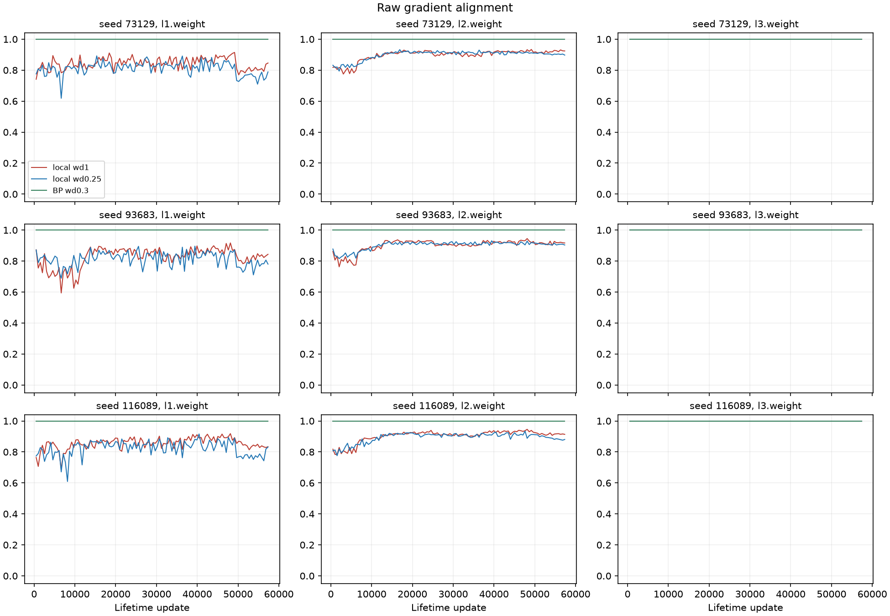
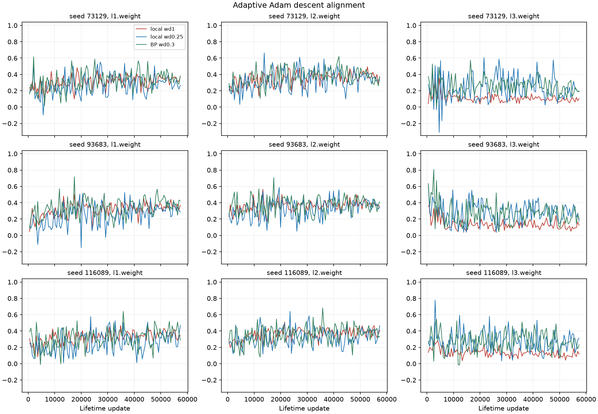
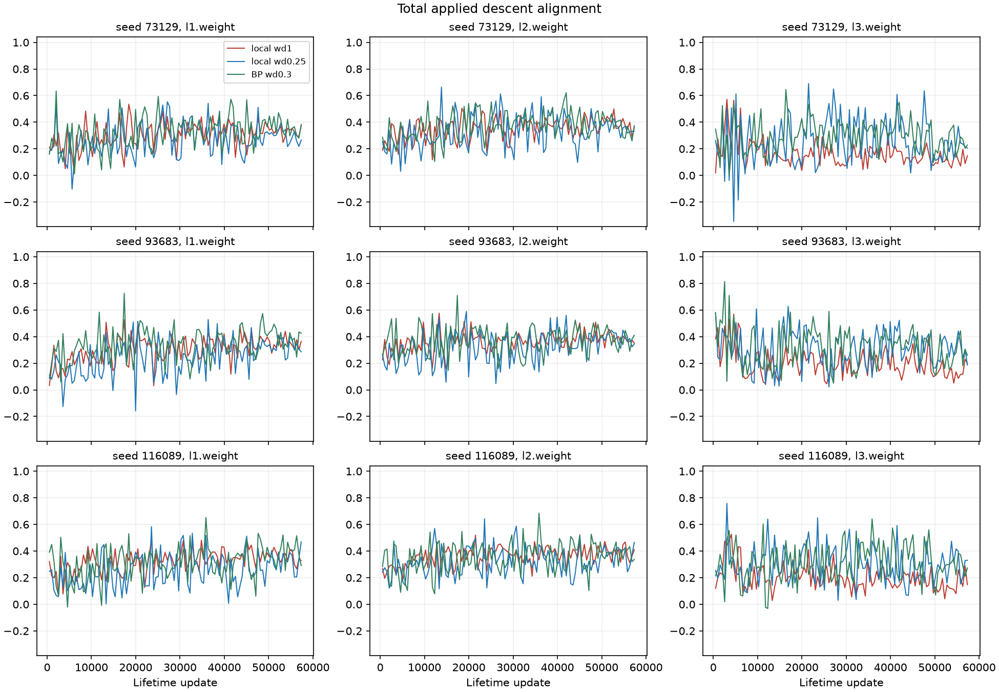
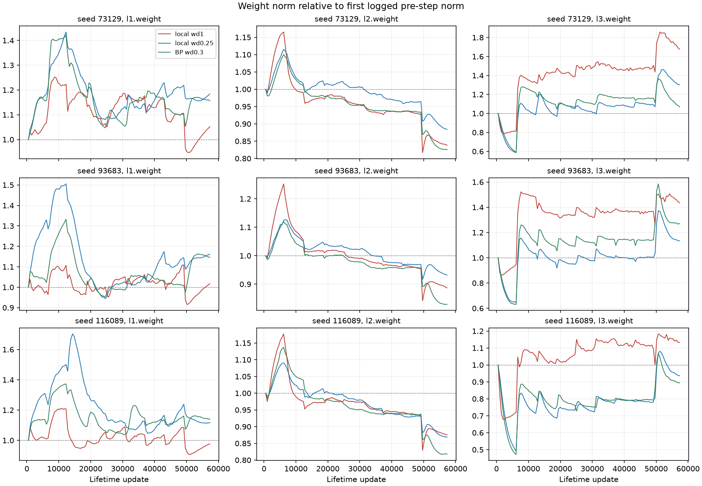
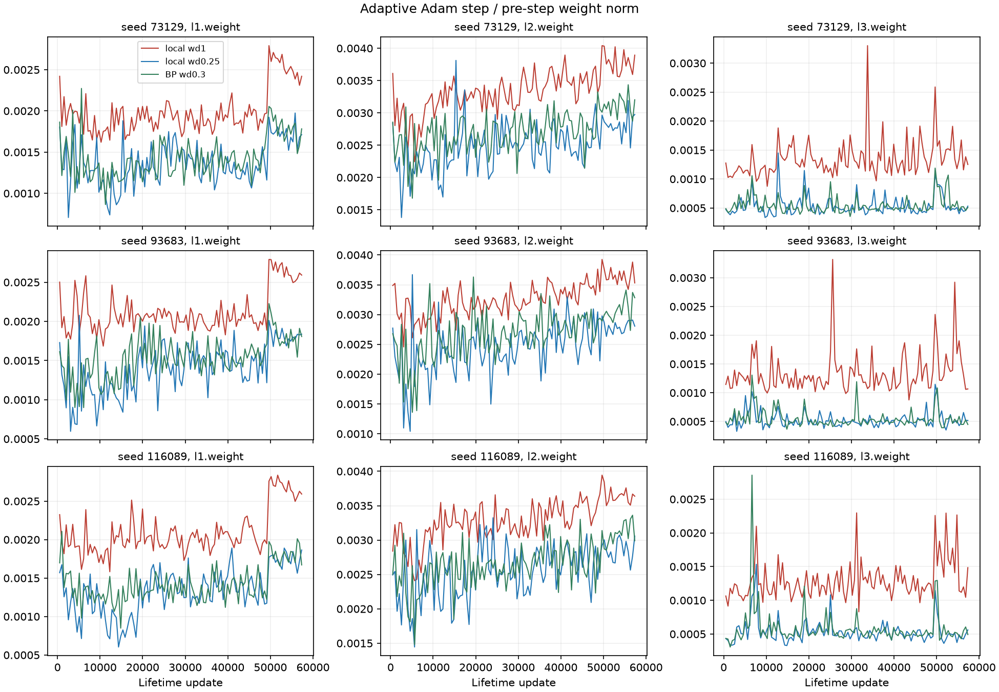

# E14 decay confirmation final results

**Complete: 46 planned subprocesses.** Six fresh births, 39 lives (including the logged C baseline profile), and one additional E7 default profile. Forty numeric zero exit codes were observed; the six adopted births have verified complete artifacts and observed process exits, but their numeric exit codes are unknown. All ten required history comparisons match exactly after excluding `cpu` timing only.

## Outcome

Lower decay transfers strongly to fresh seeds, but the full E8 prediction does not pass every seed. E8 final retention is 93.46-94.54%; held composition is 84.58%, 76.67% and 72.04% (the last misses the predeclared 75% threshold). E7 low-decay held composition is 88.67-90.04%, only 2.17-3.21 points below matched fresh BP; both E7 packages pass their 80% and 10-point-gap gates in every seed.

The standing-seed curves support a broad 0.1-0.25 plateau on the declared mean endpoints. The predicted sharp five-point composition drop at 0.5 is absent in all three E8 seeds. No operating point was selected by rerunning or replacing a seed.

The diagnostic predictions do not establish a missing-feedback mechanism: hidden raw-gradient alignment is not generally below 0.5, and low Adam-descent cosine must be compared with the BP reference, which also has much lower applied-step than raw-gradient alignment. These observations are on actual training batches, including replay pseudo-labels, not an oracle for their truth. Detailed per-seed/layer verdicts follow.

The E8 average also hides a specific failure: seed 400009 scores 18.67% on the `+-` final answer and 19.83% on its intermediate answer, versus matched BP 83.33% and 88.83%, despite 94.54% old-operation retention. Better retention does not by itself establish robust composition after continued learning.

Across the six local diagnostic lives, mean hidden-weight raw cosines are 0.811-0.903, above the predicted below-0.5 range. The hidden adaptive-step/weight ratios at decay 1 versus 0.25 are 1.29-1.57, below the predicted factor of two. Second-layer weight norms fall in all seeds, while first-layer norms fall in only one. Raw values with tiny floating-point cosine overshoots above one are preserved.

Fresh-seed confirmation uses the same implementation and source recipes; it is not an independent-code replication. The operative learner is the 18-byte-window, hidden 512, 470,801-parameter E7/E8 network. Fitting at birth uses BP; local lifetime sign-feedback learning and the joint-ground-truth BP ceiling are separate evidence conditions.

## A: fresh E8 seeds

|Seed|Arm|Stage8 mean|Final mean|Held composition|
|---|---|---:|---:|---:|
|200003|A_C|93.88|94.50|84.58|
|200003|A_D|95.52|94.25|89.42|
|300007|A_C|94.15|93.46|76.67|
|300007|A_D|96.73|93.98|88.38|
|400009|A_C|95.00|94.54|72.04|
|400009|A_D|97.17|95.90|90.29|

## A: fresh E7 seeds

|Seed|Arm|Held final mean|Full scratchpad mean|Within final|Signed BP-minus-local gap|
|---|---|---:|---:|---:|---:|
|200003|A_batch256|86.04|84.12|86.50|+6.17|
|200003|A_decay025|90.04|88.63|92.33|+2.17|
|200003|A_BP|92.21|91.67|94.33|+0.00|
|300007|A_batch256|83.62|81.96|90.33|+8.25|
|300007|A_decay025|88.67|87.58|91.83|+3.21|
|300007|A_BP|91.88|91.33|93.17|+0.00|
|400009|A_batch256|86.79|85.04|89.17|+5.33|
|400009|A_decay025|89.67|88.33|91.83|+2.46|
|400009|A_BP|92.12|91.29|92.83|+0.00|

## B: standing-seed E8 curve

|Seed|Decay|Stage8 mean|Final mean|Held composition|Origin|
|---|---:|---:|---:|---:|---|
|73129|0.1|94.27|94.73|82.04|new|
|73129|0.25|94.58|93.75|82.29|reused|
|73129|0.5|93.60|91.23|78.62|new|
|73129|1.0|90.13|79.79|54.92|reused|
|93683|0.1|95.60|94.94|79.33|new|
|93683|0.25|95.27|94.06|81.00|reused|
|93683|0.5|93.69|91.83|78.33|new|
|93683|1.0|88.83|76.17|51.67|reused|
|116089|0.1|95.54|95.33|85.04|new|
|116089|0.25|95.52|94.58|85.00|reused|
|116089|0.5|93.83|92.17|81.42|new|
|116089|1.0|88.73|77.60|48.29|reused|

## B: standing-seed E7 curve

|Seed|Decay|Held final mean|Within final|Full scratchpad mean|Origin|
|---|---:|---:|---:|---:|---|
|73129|0.1|91.67|93.00|90.71|new|
|73129|0.25|92.37|92.17|91.33|new|
|73129|0.5|88.46|88.67|87.25|new|
|73129|1.0|74.96|77.67|72.04|reused|
|93683|0.1|89.79|91.17|88.50|new|
|93683|0.25|89.42|92.33|88.62|new|
|93683|0.5|86.17|89.50|84.33|new|
|93683|1.0|62.33|69.17|58.42|reused|
|116089|0.1|91.88|93.33|90.92|new|
|116089|0.25|91.71|94.00|90.29|new|
|116089|0.5|88.67|91.50|86.33|new|
|116089|1.0|75.88|79.17|71.75|reused|

All nine fresh E7 lives have zero complete standalone exact responses at their final composition checkpoint, although many final-answer suffixes remain correct. This is reported separately from the successful composition gate; it prevents treating E7 alone as a complete persistent standalone-and-composition demonstration.

## C diagnostic summaries

Means are across 112 checkpoints per life. Raw gradient, adaptive Adam descent excluding decay, and total applied descent including decay have separate columns. Norm endpoints begin at update 512 and end at 57,344; they are not birth-to-death norms. Biases remain separate. Low-decay stability had no numeric tolerance in the lock, so no new stability pass threshold is invented.

### Weight tensors

|Seed|Arm|Tensor|Raw cos|Adam cos|Total cos|Adam step/weight|First norm|Last norm|Last/first|
|---|---|---|---|---|---|---|---|---|---|
|73129|C_wd1|l1.weight|0.842779|0.307141|0.302209|0.001995|22.585194|23.756814|1.051876|
|73129|C_wd1|l2.weight|0.897551|0.352422|0.351588|0.003342|35.679708|29.909468|0.838277|
|73129|C_wd1|l3.weight|1.000000|0.112936|0.165727|0.001345|33.398148|56.001176|1.676775|
|73129|C_wd025|l1.weight|0.811214|0.268992|0.268517|0.001370|26.373465|31.220898|1.183800|
|73129|C_wd025|l2.weight|0.898171|0.326531|0.326342|0.002486|43.507923|38.448039|0.883702|
|73129|C_wd025|l3.weight|1.000000|0.235716|0.256393|0.000538|43.932531|57.292951|1.304112|
|73129|C_BP|l1.weight|1.000000|0.322187|0.324477|0.001431|25.999511|30.059771|1.156167|
|73129|C_BP|l2.weight|1.000000|0.373546|0.373935|0.002722|42.543411|35.115306|0.825399|
|73129|C_BP|l3.weight|1.000000|0.253590|0.297626|0.000550|43.006977|45.980300|1.069136|
|93683|C_wd1|l1.weight|0.825883|0.313988|0.305443|0.002128|22.590436|22.980279|1.017257|
|93683|C_wd1|l2.weight|0.901185|0.360528|0.360310|0.003270|35.293867|31.303478|0.886938|
|93683|C_wd1|l3.weight|1.000000|0.134803|0.201049|0.001341|32.438825|46.576782|1.435834|
|93683|C_wd025|l1.weight|0.812363|0.247101|0.245515|0.001405|26.359487|30.617607|1.161540|
|93683|C_wd025|l2.weight|0.901763|0.324832|0.324628|0.002461|42.896380|39.996418|0.932396|
|93683|C_wd025|l3.weight|1.000000|0.283246|0.311515|0.000528|41.623663|47.184376|1.133595|
|93683|C_BP|l1.weight|1.000000|0.338587|0.339757|0.001534|25.886825|29.676424|1.146391|
|93683|C_BP|l2.weight|1.000000|0.372305|0.372610|0.002694|41.898262|34.762949|0.829699|
|93683|C_BP|l3.weight|1.000000|0.272089|0.319042|0.000550|40.394210|51.342852|1.271045|
|116089|C_wd1|l1.weight|0.855693|0.325991|0.324627|0.002095|22.965647|22.446199|0.977382|
|116089|C_wd1|l2.weight|0.903449|0.361827|0.362176|0.003289|35.908244|31.441250|0.875600|
|116089|C_wd1|l3.weight|1.000000|0.134682|0.202876|0.001290|41.152602|46.617514|1.132796|
|116089|C_wd025|l1.weight|0.823139|0.254640|0.255047|0.001334|27.176464|30.357452|1.117049|
|116089|C_wd025|l2.weight|0.893677|0.322543|0.322460|0.002557|44.290215|38.481927|0.868858|
|116089|C_wd025|l3.weight|1.000000|0.273570|0.298119|0.000536|55.416641|51.867179|0.935950|
|116089|C_BP|l1.weight|1.000000|0.313590|0.315633|0.001426|26.219248|29.852158|1.138559|
|116089|C_BP|l2.weight|1.000000|0.353089|0.353347|0.002665|43.355421|35.486989|0.818513|
|116089|C_BP|l3.weight|1.000000|0.274400|0.315122|0.000578|53.892737|48.170670|0.893825|

### Bias tensors

|Seed|Arm|Tensor|Raw cos|Adam cos|Total cos|Adam step/weight|First norm|Last norm|Last/first|
|---|---|---|---|---|---|---|---|---|---|
|73129|C_wd1|l1.bias|0.834357|0.286652|0.295268|0.003535|1.467885|1.268638|0.864263|
|73129|C_wd1|l2.bias|0.895835|0.348054|0.351377|0.005805|1.002213|0.686418|0.684902|
|73129|C_wd1|l3.bias|1.000000|0.029047|0.230070|0.000984|12.640342|11.555285|0.914159|
|73129|C_wd025|l1.bias|0.812732|0.326631|0.326394|0.003013|1.739077|1.754191|1.008691|
|73129|C_wd025|l2.bias|0.898498|0.329109|0.329264|0.003951|1.312123|1.000372|0.762407|
|73129|C_wd025|l3.bias|1.000000|0.072032|0.230304|0.000254|17.479903|26.541905|1.518424|
|73129|C_BP|l1.bias|1.000000|0.363918|0.365085|0.003298|1.707021|1.588164|0.930372|
|73129|C_BP|l2.bias|1.000000|0.368729|0.369201|0.004117|1.285254|0.929356|0.723091|
|73129|C_BP|l3.bias|1.000000|0.072537|0.260707|0.000291|16.978182|15.187963|0.894558|
|93683|C_wd1|l1.bias|0.820045|0.327334|0.335516|0.003425|1.561494|1.335167|0.855058|
|93683|C_wd1|l2.bias|0.902149|0.377469|0.379845|0.005750|0.972246|0.670218|0.689350|
|93683|C_wd1|l3.bias|1.000000|0.041202|0.277209|0.000992|9.934840|10.540651|1.060979|
|93683|C_wd025|l1.bias|0.800380|0.249924|0.253127|0.002760|1.906866|1.947047|1.021072|
|93683|C_wd025|l2.bias|0.903213|0.332452|0.333301|0.003846|1.251697|1.042773|0.833087|
|93683|C_wd025|l3.bias|1.000000|0.122762|0.301845|0.000260|13.723591|16.025462|1.167731|
|93683|C_BP|l1.bias|1.000000|0.390255|0.389130|0.002764|1.867652|1.621614|0.868263|
|93683|C_BP|l2.bias|1.000000|0.361650|0.361717|0.004106|1.237954|0.870160|0.702902|
|93683|C_BP|l3.bias|1.000000|0.093660|0.251349|0.000308|13.353863|13.646815|1.021938|
|116089|C_wd1|l1.bias|0.856406|0.365949|0.369303|0.003418|1.166193|1.239988|1.063279|
|116089|C_wd1|l2.bias|0.904122|0.375176|0.377238|0.005540|0.947636|0.712948|0.752344|
|116089|C_wd1|l3.bias|1.000000|0.033377|0.239009|0.000961|19.224692|9.639649|0.501420|
|116089|C_wd025|l1.bias|0.822930|0.269440|0.269211|0.003054|1.358408|1.719184|1.265587|
|116089|C_wd025|l2.bias|0.893940|0.323137|0.323579|0.003875|1.259421|1.062557|0.843687|
|116089|C_wd025|l3.bias|1.000000|0.094982|0.244375|0.000248|26.802347|19.991143|0.745873|
|116089|C_BP|l1.bias|1.000000|0.325790|0.323235|0.003154|1.333083|1.548810|1.161826|
|116089|C_BP|l2.bias|1.000000|0.340744|0.340791|0.004096|1.236356|0.919346|0.743593|
|116089|C_BP|l3.bias|1.000000|0.082258|0.237382|0.000299|26.005380|14.381404|0.553016|

Full first/last/min/max norms are in [E14_DIAGNOSTIC_SUMMARY.json](E14_DIAGNOSTIC_SUMMARY.json); all 6,048 parameter/checkpoint rows and stages are in [E14_DIAGNOSTIC_CURVES.csv](E14_DIAGNOSTIC_CURVES.csv).

## Prediction verdicts

|Prediction|Result|Observed detail|
|---|---|---|
|A E8 seed 200003|PASS|{"final": 94.5, "held": 84.58333333333333, "stage8": 93.875}|
|A E7 batch256 seed 200003|PASS|{"BP": 92.20833333333333, "full": 84.125, "held": 86.04166666666666, "signed_BP_minus_local": 6.166666666666671, "within": 86.5}|
|A E7 decay025 seed 200003|PASS|{"BP": 92.20833333333333, "full": 88.625, "held": 90.04166666666667, "signed_BP_minus_local": 2.166666666666657, "within": 92.33333333333333}|
|A E8 seed 300007|PASS|{"final": 93.45833333333334, "held": 76.66666666666667, "stage8": 94.14583333333334}|
|A E7 batch256 seed 300007|PASS|{"BP": 91.875, "full": 81.95833333333333, "held": 83.625, "signed_BP_minus_local": 8.25, "within": 90.33333333333333}|
|A E7 decay025 seed 300007|PASS|{"BP": 91.875, "full": 87.58333333333333, "held": 88.66666666666666, "signed_BP_minus_local": 3.208333333333343, "within": 91.83333333333333}|
|A E8 seed 400009|MISS|{"final": 94.54166666666667, "held": 72.04166666666667, "stage8": 95.0}|
|A E7 batch256 seed 400009|PASS|{"BP": 92.125, "full": 85.04166666666667, "held": 86.79166666666666, "signed_BP_minus_local": 5.333333333333343, "within": 89.16666666666667}|
|A E7 decay025 seed 400009|PASS|{"BP": 92.125, "full": 88.33333333333333, "held": 89.66666666666667, "signed_BP_minus_local": 2.4583333333333286, "within": 91.83333333333333}|
|B E8 plateau seed 73129|PASS|{"delta_010_minus_025": [-0.3125, 0.9791666666666714, -0.25]}|
|B E7 plateau seed 73129|PASS|{"delta_010_minus_025": [-0.7083333333333428, 0.8333333333333286, -0.625]}|
|B E8 wd0.5 composition drop seed 73129|MISS|{"drop_points": 3.6666666666666714}|
|B E8 plateau seed 93683|PASS|{"delta_010_minus_025": [0.3333333333333428, 0.875, -1.6666666666666714]}|
|B E7 plateau seed 93683|PASS|{"delta_010_minus_025": [0.3750000000000142, -1.1666666666666572, -0.125]}|
|B E8 wd0.5 composition drop seed 93683|MISS|{"drop_points": 2.666666666666657}|
|B E8 plateau seed 116089|PASS|{"delta_010_minus_025": [0.020833333333342807, 0.75, 0.04166666666665719]}|
|B E7 plateau seed 116089|PASS|{"delta_010_minus_025": [0.1666666666666714, -0.6666666666666714, 0.6250000000000142]}|
|B E8 wd0.5 composition drop seed 116089|MISS|{"drop_points": 3.5833333333333286}|
|C raw alignment 73129 C_wd1 l1.weight|MISS|{"mean_raw_cosine": 0.8427788876943549}|
|C hidden norm falls 73129 l1.weight|MISS|{"endpoint_ratio": 1.051875560789138}|
|C raw alignment 73129 C_wd1 l2.weight|MISS|{"mean_raw_cosine": 0.8975506690172469}|
|C hidden norm falls 73129 l2.weight|PASS|{"endpoint_ratio": 0.8382766953169987}|
|C raw alignment 73129 C_wd1 l3.weight|PASS|{"mean_raw_cosine": 1.0000000000001705}|
|C raw alignment 73129 C_wd025 l1.weight|MISS|{"mean_raw_cosine": 0.8112139127862465}|
|C raw alignment 73129 C_wd025 l2.weight|MISS|{"mean_raw_cosine": 0.8981706609307466}|
|C raw alignment 73129 C_wd025 l3.weight|PASS|{"mean_raw_cosine": 1.0000000000002685}|
|C raw alignment 93683 C_wd1 l1.weight|MISS|{"mean_raw_cosine": 0.8258830002206893}|
|C hidden norm falls 93683 l1.weight|MISS|{"endpoint_ratio": 1.0172570110061192}|
|C raw alignment 93683 C_wd1 l2.weight|MISS|{"mean_raw_cosine": 0.9011853173799901}|
|C hidden norm falls 93683 l2.weight|PASS|{"endpoint_ratio": 0.8869381723720361}|
|C raw alignment 93683 C_wd1 l3.weight|PASS|{"mean_raw_cosine": 1.0000000000002505}|
|C raw alignment 93683 C_wd025 l1.weight|MISS|{"mean_raw_cosine": 0.8123634570352904}|
|C raw alignment 93683 C_wd025 l2.weight|MISS|{"mean_raw_cosine": 0.9017629999259497}|
|C raw alignment 93683 C_wd025 l3.weight|PASS|{"mean_raw_cosine": 1.000000000000311}|
|C raw alignment 116089 C_wd1 l1.weight|MISS|{"mean_raw_cosine": 0.855692959054177}|
|C hidden norm falls 116089 l1.weight|PASS|{"endpoint_ratio": 0.977381508500995}|
|C raw alignment 116089 C_wd1 l2.weight|MISS|{"mean_raw_cosine": 0.9034485478311437}|
|C hidden norm falls 116089 l2.weight|PASS|{"endpoint_ratio": 0.8755997666051261}|
|C raw alignment 116089 C_wd1 l3.weight|PASS|{"mean_raw_cosine": 1.0000000000002196}|
|C raw alignment 116089 C_wd025 l1.weight|MISS|{"mean_raw_cosine": 0.8231392576518334}|
|C raw alignment 116089 C_wd025 l2.weight|MISS|{"mean_raw_cosine": 0.8936772471432888}|
|C raw alignment 116089 C_wd025 l3.weight|PASS|{"mean_raw_cosine": 1.000000000000343}|
|C adaptive-step/weight ratio 73129 l1.weight|MISS|{"wd1_over_wd025": 1.4569260765252305}|
|C adaptive-step/weight ratio 73129 l2.weight|MISS|{"wd1_over_wd025": 1.3442565107340811}|
|C adaptive-step/weight ratio 93683 l1.weight|MISS|{"wd1_over_wd025": 1.5148125204895433}|
|C adaptive-step/weight ratio 93683 l2.weight|MISS|{"wd1_over_wd025": 1.3288325735768625}|
|C adaptive-step/weight ratio 116089 l1.weight|MISS|{"wd1_over_wd025": 1.5708547576389467}|
|C adaptive-step/weight ratio 116089 l2.weight|MISS|{"wd1_over_wd025": 1.2862069172960853}|

## Per-operation and per-pair scores

All percentages below have explicit denominators in the raw receipts. E8 retention uses the original eight life operations, not the four development operations. E7 standalone exact and final-suffix scores are both shown: a correct suffix after extra generated scratchpad bytes is not a complete standalone response. Held-composition means are averages over four pair types; they are not minimum-pair accuracy.

### A_C_200003

|Operation|n|Stage8 exact %|Final exact %|
|---|---|---|---|
|add97|600|91.666667|92.833333|
|sub97|600|88.333333|91.166667|
|max97|600|99.000000|98.333333|
|min97|600|99.333333|98.666667|
|add73|600|87.500000|89.500000|
|sub73|600|86.500000|89.000000|
|max73|600|98.833333|97.666667|
|min73|600|99.833333|98.833333|
|add89|300|8.000000|40.000000|
|sub89|300|0.000000|44.666667|
|max89|300|6.666667|3.666667|
|min89|300|12.333333|9.000000|

|Pair|n|Intermediate %|Final answer %|Full scratchpad %|
|---|---|---|---|---|
|+-|600|75.166667|67.833333|66.000000|
|-+|600|87.666667|79.500000|77.500000|
|><|600|96.166667|94.333333|92.333333|
|<>|600|97.500000|96.666667|95.333333|
|within|600|92.166667|87.500000|86.500000|

### A_D_200003

|Operation|n|Stage8 exact %|Final exact %|
|---|---|---|---|
|add97|600|93.500000|93.833333|
|sub97|600|93.666667|92.333333|
|max97|600|98.333333|98.333333|
|min97|600|98.166667|99.000000|
|add73|600|92.000000|85.833333|
|sub73|600|92.000000|88.500000|
|max73|600|98.500000|97.000000|
|min73|600|98.000000|99.166667|
|add89|300|0.000000|37.333333|
|sub89|300|3.000000|39.666667|
|max89|300|2.666667|2.333333|
|min89|300|1.333333|12.000000|

|Pair|n|Intermediate %|Final answer %|Full scratchpad %|
|---|---|---|---|---|
|+-|600|88.833333|82.500000|80.166667|
|-+|600|92.666667|84.500000|83.333333|
|><|600|95.833333|95.666667|92.833333|
|<>|600|97.166667|95.000000|93.333333|
|within|600|93.666667|87.500000|86.333333|

### A_batch256_200003

|Standalone operation|n|Complete exact %|Final suffix %|
|---|---|---|---|
|+|600|0.000000|88.166667|
|-|600|0.000000|88.500000|
|>|600|0.000000|83.666667|
|<|600|0.000000|73.500000|

|Pair|n|Intermediate %|Final answer %|Full scratchpad %|
|---|---|---|---|---|
|+-|600|90.333333|79.500000|77.000000|
|-+|600|89.833333|77.333333|75.666667|
|><|600|96.500000|94.500000|92.833333|
|<>|600|96.166667|92.833333|91.000000|
|within|600|94.000000|86.500000|85.500000|

### A_decay025_200003

|Standalone operation|n|Complete exact %|Final suffix %|
|---|---|---|---|
|+|600|0.000000|71.833333|
|-|600|0.000000|80.166667|
|>|600|0.000000|78.333333|
|<|600|0.000000|66.500000|

|Pair|n|Intermediate %|Final answer %|Full scratchpad %|
|---|---|---|---|---|
|+-|600|93.000000|86.166667|84.500000|
|-+|600|90.500000|82.000000|81.166667|
|><|600|96.166667|96.333333|94.166667|
|<>|600|98.000000|95.666667|94.666667|
|within|600|97.333333|92.333333|92.000000|

### A_BP_200003

|Standalone operation|n|Complete exact %|Final suffix %|
|---|---|---|---|
|+|600|0.000000|27.500000|
|-|600|0.000000|35.833333|
|>|600|0.000000|31.166667|
|<|600|0.000000|34.166667|

|Pair|n|Intermediate %|Final answer %|Full scratchpad %|
|---|---|---|---|---|
|+-|600|94.666667|87.333333|86.833333|
|-+|600|93.500000|88.000000|87.500000|
|><|600|98.666667|97.666667|97.166667|
|<>|600|98.666667|95.833333|95.166667|
|within|600|97.666667|94.333333|94.166667|

### A_C_300007

|Operation|n|Stage8 exact %|Final exact %|
|---|---|---|---|
|add97|600|89.500000|94.166667|
|sub97|600|91.666667|93.666667|
|max97|600|98.166667|98.000000|
|min97|600|99.166667|97.500000|
|add73|600|89.500000|82.666667|
|sub73|600|86.666667|87.833333|
|max73|600|99.166667|97.666667|
|min73|600|99.333333|96.166667|
|add89|300|35.000000|18.666667|
|sub89|300|3.000000|43.333333|
|max89|300|77.000000|48.333333|
|min89|300|95.333333|22.333333|

|Pair|n|Intermediate %|Final answer %|Full scratchpad %|
|---|---|---|---|---|
|+-|600|60.500000|53.166667|52.500000|
|-+|600|80.833333|72.166667|69.166667|
|><|600|95.500000|93.166667|91.166667|
|<>|600|93.166667|88.166667|85.500000|
|within|600|92.666667|88.666667|87.333333|

### A_D_300007

|Operation|n|Stage8 exact %|Final exact %|
|---|---|---|---|
|add97|600|95.166667|93.333333|
|sub97|600|95.666667|92.833333|
|max97|600|98.666667|98.000000|
|min97|600|99.500000|97.666667|
|add73|600|92.000000|88.000000|
|sub73|600|94.166667|85.833333|
|max73|600|98.666667|98.500000|
|min73|600|100.000000|97.666667|
|add89|300|5.000000|32.333333|
|sub89|300|0.666667|29.000000|
|max89|300|47.000000|14.666667|
|min89|300|62.666667|45.666667|

|Pair|n|Intermediate %|Final answer %|Full scratchpad %|
|---|---|---|---|---|
|+-|600|88.500000|81.666667|80.833333|
|-+|600|89.500000|82.333333|81.666667|
|><|600|97.500000|96.333333|94.500000|
|<>|600|96.000000|93.166667|91.333333|
|within|600|95.000000|90.666667|89.666667|

### A_batch256_300007

|Standalone operation|n|Complete exact %|Final suffix %|
|---|---|---|---|
|+|600|0.000000|78.666667|
|-|600|0.000000|74.000000|
|>|600|0.000000|78.500000|
|<|600|0.000000|85.500000|

|Pair|n|Intermediate %|Final answer %|Full scratchpad %|
|---|---|---|---|---|
|+-|600|91.000000|79.500000|78.333333|
|-+|600|90.000000|71.500000|69.333333|
|><|600|96.500000|93.666667|91.500000|
|<>|600|96.833333|89.833333|88.666667|
|within|600|94.666667|90.333333|89.000000|

### A_decay025_300007

|Standalone operation|n|Complete exact %|Final suffix %|
|---|---|---|---|
|+|600|0.000000|69.333333|
|-|600|0.000000|69.833333|
|>|600|0.000000|79.000000|
|<|600|0.000000|84.166667|

|Pair|n|Intermediate %|Final answer %|Full scratchpad %|
|---|---|---|---|---|
|+-|600|92.000000|83.333333|82.333333|
|-+|600|91.833333|82.000000|80.833333|
|><|600|98.166667|96.833333|95.500000|
|<>|600|98.166667|92.500000|91.666667|
|within|600|95.333333|91.833333|90.833333|

### A_BP_300007

|Standalone operation|n|Complete exact %|Final suffix %|
|---|---|---|---|
|+|600|0.000000|45.833333|
|-|600|0.000000|35.000000|
|>|600|0.000000|57.500000|
|<|600|0.000000|53.666667|

|Pair|n|Intermediate %|Final answer %|Full scratchpad %|
|---|---|---|---|---|
|+-|600|92.500000|86.666667|86.000000|
|-+|600|96.000000|88.333333|87.833333|
|><|600|99.000000|96.500000|96.000000|
|<>|600|99.166667|96.000000|95.500000|
|within|600|96.666667|93.166667|92.833333|

### A_C_400009

|Operation|n|Stage8 exact %|Final exact %|
|---|---|---|---|
|add97|600|93.333333|95.166667|
|sub97|600|92.166667|93.166667|
|max97|600|97.333333|97.500000|
|min97|600|99.500000|97.833333|
|add73|600|90.666667|90.833333|
|sub73|600|90.000000|88.166667|
|max73|600|98.166667|97.000000|
|min73|600|98.833333|96.666667|
|add89|300|29.333333|34.000000|
|sub89|300|0.666667|43.666667|
|max89|300|29.000000|5.000000|
|min89|300|29.666667|9.666667|

|Pair|n|Intermediate %|Final answer %|Full scratchpad %|
|---|---|---|---|---|
|+-|600|19.833333|18.666667|17.333333|
|-+|600|84.666667|79.833333|78.333333|
|><|600|95.833333|94.500000|92.333333|
|<>|600|96.166667|95.166667|92.666667|
|within|600|93.333333|90.166667|88.833333|

### A_D_400009

|Operation|n|Stage8 exact %|Final exact %|
|---|---|---|---|
|add97|600|96.833333|95.166667|
|sub97|600|95.166667|95.333333|
|max97|600|99.333333|98.333333|
|min97|600|99.500000|98.500000|
|add73|600|95.166667|91.500000|
|sub73|600|92.500000|91.166667|
|max73|600|99.500000|98.500000|
|min73|600|99.333333|98.666667|
|add89|300|0.000000|26.333333|
|sub89|300|8.000000|36.666667|
|max89|300|0.000000|10.666667|
|min89|300|6.333333|37.666667|

|Pair|n|Intermediate %|Final answer %|Full scratchpad %|
|---|---|---|---|---|
|+-|600|88.833333|83.333333|82.333333|
|-+|600|91.500000|86.666667|85.666667|
|><|600|96.833333|94.333333|93.166667|
|<>|600|96.166667|96.833333|94.833333|
|within|600|94.833333|91.833333|90.833333|

### A_batch256_400009

|Standalone operation|n|Complete exact %|Final suffix %|
|---|---|---|---|
|+|600|0.000000|32.000000|
|-|600|0.000000|20.000000|
|>|600|0.000000|54.666667|
|<|600|0.000000|82.666667|

|Pair|n|Intermediate %|Final answer %|Full scratchpad %|
|---|---|---|---|---|
|+-|600|92.000000|79.833333|78.000000|
|-+|600|91.333333|78.333333|77.500000|
|><|600|96.666667|94.666667|93.000000|
|<>|600|95.666667|94.333333|91.666667|
|within|600|93.666667|89.166667|87.333333|

### A_decay025_400009

|Standalone operation|n|Complete exact %|Final suffix %|
|---|---|---|---|
|+|600|0.000000|3.166667|
|-|600|0.000000|0.000000|
|>|600|0.000000|0.000000|
|<|600|0.000000|0.500000|

|Pair|n|Intermediate %|Final answer %|Full scratchpad %|
|---|---|---|---|---|
|+-|600|92.000000|85.166667|83.333333|
|-+|600|90.833333|82.166667|81.333333|
|><|600|98.166667|96.666667|95.666667|
|<>|600|96.333333|94.666667|93.000000|
|within|600|96.000000|91.833333|90.666667|

### A_BP_400009

|Standalone operation|n|Complete exact %|Final suffix %|
|---|---|---|---|
|+|600|0.000000|50.833333|
|-|600|0.000000|59.833333|
|>|600|0.000000|55.500000|
|<|600|0.000000|49.666667|

|Pair|n|Intermediate %|Final answer %|Full scratchpad %|
|---|---|---|---|---|
|+-|600|93.333333|86.500000|86.000000|
|-+|600|94.333333|87.000000|86.500000|
|><|600|99.166667|98.166667|97.500000|
|<>|600|97.166667|96.833333|95.166667|
|within|600|96.500000|92.833333|92.000000|

### B_E8_wd010_73129

|Operation|n|Stage8 exact %|Final exact %|
|---|---|---|---|
|add97|600|91.500000|92.166667|
|sub97|600|89.500000|94.166667|
|max97|600|99.500000|97.333333|
|min97|600|99.333333|98.666667|
|add73|600|87.500000|87.333333|
|sub73|600|87.833333|90.500000|
|max73|600|99.500000|98.833333|
|min73|600|99.500000|98.833333|
|add89|300|28.666667|15.000000|
|sub89|300|1.666667|46.666667|
|max89|300|55.000000|27.000000|
|min89|300|0.333333|0.000000|

|Pair|n|Intermediate %|Final answer %|Full scratchpad %|
|---|---|---|---|---|
|+-|600|77.333333|67.166667|65.333333|
|-+|600|78.500000|69.666667|68.166667|
|><|600|95.000000|96.333333|93.000000|
|<>|600|94.000000|95.000000|91.833333|
|within|600|91.000000|86.333333|84.666667|

### B_E8_wd050_73129

|Operation|n|Stage8 exact %|Final exact %|
|---|---|---|---|
|add97|600|92.500000|89.333333|
|sub97|600|89.500000|88.500000|
|max97|600|97.833333|96.666667|
|min97|600|98.666667|96.833333|
|add73|600|88.500000|80.500000|
|sub73|600|85.666667|84.000000|
|max73|600|97.333333|96.166667|
|min73|600|98.833333|97.833333|
|add89|300|0.333333|32.333333|
|sub89|300|30.000000|48.333333|
|max89|300|1.000000|3.000000|
|min89|300|24.333333|8.000000|

|Pair|n|Intermediate %|Final answer %|Full scratchpad %|
|---|---|---|---|---|
|+-|600|67.500000|60.500000|58.500000|
|-+|600|80.000000|71.333333|69.166667|
|><|600|93.833333|91.166667|87.833333|
|<>|600|92.333333|91.500000|87.333333|
|within|600|88.333333|83.666667|80.833333|

### B_E7_wd010_73129

|Standalone operation|n|Complete exact %|Final suffix %|
|---|---|---|---|
|+|600|0.000000|0.000000|
|-|600|0.000000|0.000000|
|>|600|0.000000|0.000000|
|<|600|0.000000|0.000000|

|Pair|n|Intermediate %|Final answer %|Full scratchpad %|
|---|---|---|---|---|
|+-|600|91.833333|86.333333|84.666667|
|-+|600|92.000000|84.833333|83.833333|
|><|600|98.666667|97.333333|96.500000|
|<>|600|99.333333|98.166667|97.833333|
|within|600|96.833333|93.000000|92.666667|

### B_E7_wd025_73129

|Standalone operation|n|Complete exact %|Final suffix %|
|---|---|---|---|
|+|600|0.000000|0.000000|
|-|600|0.000000|0.000000|
|>|600|0.000000|0.000000|
|<|600|0.000000|0.000000|

|Pair|n|Intermediate %|Final answer %|Full scratchpad %|
|---|---|---|---|---|
|+-|600|92.500000|86.000000|84.333333|
|-+|600|93.333333|88.333333|87.500000|
|><|600|98.166667|96.333333|95.333333|
|<>|600|99.000000|98.833333|98.166667|
|within|600|96.166667|92.166667|92.000000|

### B_E7_wd050_73129

|Standalone operation|n|Complete exact %|Final suffix %|
|---|---|---|---|
|+|600|0.000000|0.000000|
|-|600|0.000000|0.000000|
|>|600|0.000000|29.500000|
|<|600|0.000000|5.000000|

|Pair|n|Intermediate %|Final answer %|Full scratchpad %|
|---|---|---|---|---|
|+-|600|91.833333|81.666667|79.666667|
|-+|600|91.500000|83.166667|82.833333|
|><|600|97.000000|93.833333|92.000000|
|<>|600|98.000000|95.166667|94.500000|
|within|600|95.000000|88.666667|87.833333|

### B_E8_wd010_93683

|Operation|n|Stage8 exact %|Final exact %|
|---|---|---|---|
|add97|600|93.166667|94.333333|
|sub97|600|92.000000|92.333333|
|max97|600|98.833333|99.000000|
|min97|600|99.333333|97.833333|
|add73|600|91.166667|90.500000|
|sub73|600|90.666667|88.833333|
|max73|600|99.666667|99.000000|
|min73|600|100.000000|97.666667|
|add89|300|31.666667|10.000000|
|sub89|300|10.666667|25.666667|
|max89|300|57.333333|11.333333|
|min89|300|84.000000|12.000000|

|Pair|n|Intermediate %|Final answer %|Full scratchpad %|
|---|---|---|---|---|
|+-|600|71.000000|60.000000|58.833333|
|-+|600|78.166667|68.500000|67.333333|
|><|600|95.666667|94.000000|91.666667|
|<>|600|95.666667|94.833333|91.833333|
|within|600|92.000000|88.166667|86.833333|

### B_E8_wd050_93683

|Operation|n|Stage8 exact %|Final exact %|
|---|---|---|---|
|add97|600|91.833333|92.166667|
|sub97|600|88.666667|90.333333|
|max97|600|97.333333|94.833333|
|min97|600|98.000000|96.666667|
|add73|600|87.166667|85.500000|
|sub73|600|89.500000|82.666667|
|max73|600|98.333333|96.500000|
|min73|600|98.666667|96.000000|
|add89|300|18.000000|13.666667|
|sub89|300|0.000000|43.666667|
|max89|300|0.000000|32.666667|
|min89|300|3.666667|23.333333|

|Pair|n|Intermediate %|Final answer %|Full scratchpad %|
|---|---|---|---|---|
|+-|600|78.500000|60.500000|58.333333|
|-+|600|78.833333|68.166667|67.166667|
|><|600|93.166667|91.166667|88.500000|
|<>|600|94.833333|93.500000|90.833333|
|within|600|89.500000|83.666667|81.833333|

### B_E7_wd010_93683

|Standalone operation|n|Complete exact %|Final suffix %|
|---|---|---|---|
|+|600|0.000000|0.666667|
|-|600|0.000000|0.000000|
|>|600|0.000000|0.500000|
|<|600|0.000000|2.166667|

|Pair|n|Intermediate %|Final answer %|Full scratchpad %|
|---|---|---|---|---|
|+-|600|91.000000|83.000000|81.500000|
|-+|600|91.333333|81.833333|80.833333|
|><|600|97.666667|97.166667|96.166667|
|<>|600|97.333333|97.166667|95.500000|
|within|600|95.500000|91.166667|89.833333|

### B_E7_wd025_93683

|Standalone operation|n|Complete exact %|Final suffix %|
|---|---|---|---|
|+|600|0.000000|20.666667|
|-|600|0.000000|1.000000|
|>|600|0.000000|5.333333|
|<|600|0.000000|24.666667|

|Pair|n|Intermediate %|Final answer %|Full scratchpad %|
|---|---|---|---|---|
|+-|600|90.166667|80.833333|79.666667|
|-+|600|93.166667|84.000000|83.333333|
|><|600|99.000000|97.333333|97.000000|
|<>|600|97.500000|95.500000|94.500000|
|within|600|96.333333|92.333333|91.166667|

### B_E7_wd050_93683

|Standalone operation|n|Complete exact %|Final suffix %|
|---|---|---|---|
|+|600|0.000000|1.500000|
|-|600|0.000000|1.666667|
|>|600|0.000000|1.000000|
|<|600|0.000000|1.833333|

|Pair|n|Intermediate %|Final answer %|Full scratchpad %|
|---|---|---|---|---|
|+-|600|87.833333|78.000000|76.000000|
|-+|600|91.666667|78.666667|78.000000|
|><|600|97.166667|94.333333|92.833333|
|<>|600|96.000000|93.666667|90.500000|
|within|600|94.833333|89.500000|87.666667|

### B_E8_wd010_116089

|Operation|n|Stage8 exact %|Final exact %|
|---|---|---|---|
|add97|600|92.000000|92.833333|
|sub97|600|93.333333|94.000000|
|max97|600|99.000000|99.333333|
|min97|600|98.666667|97.333333|
|add73|600|90.000000|90.500000|
|sub73|600|93.666667|91.500000|
|max73|600|98.833333|99.166667|
|min73|600|98.833333|98.000000|
|add89|300|4.000000|35.333333|
|sub89|300|22.666667|34.666667|
|max89|300|7.000000|20.333333|
|min89|300|16.333333|16.333333|

|Pair|n|Intermediate %|Final answer %|Full scratchpad %|
|---|---|---|---|---|
|+-|600|82.833333|72.000000|70.833333|
|-+|600|84.833333|76.833333|76.000000|
|><|600|96.166667|95.833333|93.333333|
|<>|600|94.666667|95.500000|92.166667|
|within|600|93.000000|89.166667|87.166667|

### B_E8_wd050_116089

|Operation|n|Stage8 exact %|Final exact %|
|---|---|---|---|
|add97|600|92.333333|91.833333|
|sub97|600|93.166667|91.666667|
|max97|600|97.666667|96.000000|
|min97|600|96.333333|97.000000|
|add73|600|87.833333|84.833333|
|sub73|600|89.000000|85.833333|
|max73|600|97.500000|95.500000|
|min73|600|96.833333|94.666667|
|add89|300|1.333333|31.333333|
|sub89|300|0.333333|31.000000|
|max89|300|1.333333|11.666667|
|min89|300|2.000000|56.333333|

|Pair|n|Intermediate %|Final answer %|Full scratchpad %|
|---|---|---|---|---|
|+-|600|83.666667|68.666667|66.666667|
|-+|600|83.833333|73.500000|72.666667|
|><|600|93.000000|90.333333|86.500000|
|<>|600|94.000000|93.166667|89.333333|
|within|600|92.333333|87.000000|85.333333|

### B_E7_wd010_116089

|Standalone operation|n|Complete exact %|Final suffix %|
|---|---|---|---|
|+|600|0.000000|5.666667|
|-|600|0.000000|3.500000|
|>|600|0.000000|0.500000|
|<|600|0.000000|1.666667|

|Pair|n|Intermediate %|Final answer %|Full scratchpad %|
|---|---|---|---|---|
|+-|600|94.833333|88.000000|87.166667|
|-+|600|93.166667|86.500000|85.500000|
|><|600|98.500000|96.166667|95.500000|
|<>|600|98.000000|96.833333|95.500000|
|within|600|96.166667|93.333333|92.500000|

### B_E7_wd025_116089

|Standalone operation|n|Complete exact %|Final suffix %|
|---|---|---|---|
|+|600|0.000000|2.666667|
|-|600|0.000000|0.000000|
|>|600|0.000000|0.000000|
|<|600|0.000000|0.500000|

|Pair|n|Intermediate %|Final answer %|Full scratchpad %|
|---|---|---|---|---|
|+-|600|94.833333|90.000000|88.500000|
|-+|600|92.333333|84.833333|83.833333|
|><|600|96.166667|94.666667|92.500000|
|<>|600|98.500000|97.333333|96.333333|
|within|600|96.833333|94.000000|93.000000|

### B_E7_wd050_116089

|Standalone operation|n|Complete exact %|Final suffix %|
|---|---|---|---|
|+|600|0.000000|1.000000|
|-|600|0.000000|0.000000|
|>|600|0.000000|0.333333|
|<|600|0.000000|0.000000|

|Pair|n|Intermediate %|Final answer %|Full scratchpad %|
|---|---|---|---|---|
|+-|600|95.166667|85.000000|83.666667|
|-+|600|92.166667|84.166667|82.000000|
|><|600|94.166667|91.500000|87.833333|
|<>|600|96.500000|94.000000|91.833333|
|within|600|95.333333|91.500000|90.333333|

### REUSED e13_A1_e8_life_C_73129.json

|Operation|n|Stage8 exact %|Final exact %|
|---|---|---|---|
|add97|600|93.666667|92.500000|
|sub97|600|90.000000|90.166667|
|max97|600|98.833333|96.833333|
|min97|600|98.833333|98.333333|
|add73|600|88.833333|86.166667|
|sub73|600|88.166667|89.500000|
|max73|600|99.166667|98.333333|
|min73|600|99.166667|98.166667|
|add89|300|22.000000|38.333333|
|sub89|300|0.000000|47.666667|
|max89|300|96.000000|6.666667|
|min89|300|7.666667|3.333333|

|Pair|n|Intermediate %|Final answer %|Full scratchpad %|
|---|---|---|---|---|
|+-|600|68.666667|63.166667|60.000000|
|-+|600|82.333333|76.000000|74.333333|
|><|600|94.666667|96.000000|92.666667|
|<>|600|94.833333|94.000000|91.166667|
|within|600|90.666667|86.666667|84.500000|

### REUSED e8_life_C_73129.json

|Operation|n|Stage8 exact %|Final exact %|
|---|---|---|---|
|add97|600|86.500000|83.333333|
|sub97|600|84.666667|68.000000|
|max97|600|96.666667|89.333333|
|min97|600|96.333333|90.333333|
|add73|600|80.000000|64.833333|
|sub73|600|83.166667|59.166667|
|max73|600|95.833333|90.500000|
|min73|600|97.833333|92.833333|
|add89|300|14.000000|20.666667|
|sub89|300|0.333333|38.333333|
|max89|300|1.666667|24.333333|
|min89|300|1.000000|66.666667|

|Pair|n|Intermediate %|Final answer %|Full scratchpad %|
|---|---|---|---|---|
|+-|600|50.000000|31.500000|29.000000|
|-+|600|45.833333|37.500000|33.666667|
|><|600|74.500000|73.666667|62.333333|
|<>|600|84.500000|77.000000|70.333333|
|within|600|70.166667|60.666667|55.833333|

### REUSED e7_life_SCR_h512_d16384_73129.json

|Standalone operation|n|Complete exact %|Final suffix %|
|---|---|---|---|
|+|600|0.000000|0.000000|
|-|600|0.000000|0.000000|
|>|600|0.000000|0.000000|
|<|600|0.000000|0.000000|

|Pair|n|Intermediate %|Final answer %|Full scratchpad %|
|---|---|---|---|---|
|+-|600|84.833333|62.166667|58.500000|
|-+|600|86.333333|62.000000|59.833333|
|><|600|94.000000|86.500000|83.333333|
|<>|600|93.833333|89.166667|86.500000|
|within|600|91.500000|77.666667|75.666667|

### REUSED e13_A1_e8_life_C_93683.json

|Operation|n|Stage8 exact %|Final exact %|
|---|---|---|---|
|add97|600|93.000000|94.166667|
|sub97|600|91.833333|93.000000|
|max97|600|98.833333|96.166667|
|min97|600|97.833333|98.166667|
|add73|600|91.500000|89.333333|
|sub73|600|90.666667|86.333333|
|max73|600|99.166667|97.666667|
|min73|600|99.333333|97.666667|
|add89|300|15.333333|19.333333|
|sub89|300|25.666667|44.666667|
|max89|300|13.333333|5.000000|
|min89|300|14.000000|24.000000|

|Pair|n|Intermediate %|Final answer %|Full scratchpad %|
|---|---|---|---|---|
|+-|600|78.333333|67.166667|66.000000|
|-+|600|80.833333|73.000000|71.500000|
|><|600|91.833333|90.500000|88.666667|
|<>|600|95.666667|93.333333|91.333333|
|within|600|93.166667|88.333333|87.333333|

### REUSED e8_life_C_93683.json

|Operation|n|Stage8 exact %|Final exact %|
|---|---|---|---|
|add97|600|86.000000|81.000000|
|sub97|600|83.333333|64.833333|
|max97|600|96.333333|93.166667|
|min97|600|97.666667|92.500000|
|add73|600|77.666667|49.000000|
|sub73|600|75.000000|48.000000|
|max73|600|97.166667|89.500000|
|min73|600|97.500000|91.333333|
|add89|300|0.333333|9.000000|
|sub89|300|17.000000|10.333333|
|max89|300|0.666667|48.333333|
|min89|300|3.666667|24.666667|

|Pair|n|Intermediate %|Final answer %|Full scratchpad %|
|---|---|---|---|---|
|+-|600|47.666667|22.500000|20.333333|
|-+|600|45.166667|32.833333|29.833333|
|><|600|80.166667|76.666667|68.000000|
|<>|600|80.666667|74.666667|65.333333|
|within|600|70.333333|58.000000|54.666667|

### REUSED e7_life_SCR_h512_d16384_93683.json

|Standalone operation|n|Complete exact %|Final suffix %|
|---|---|---|---|
|+|600|0.000000|0.000000|
|-|600|0.000000|0.000000|
|>|600|0.000000|0.000000|
|<|600|0.000000|0.000000|

|Pair|n|Intermediate %|Final answer %|Full scratchpad %|
|---|---|---|---|---|
|+-|600|75.333333|41.666667|37.166667|
|-+|600|82.333333|42.500000|39.333333|
|><|600|92.833333|85.166667|81.500000|
|<>|600|92.333333|80.000000|75.666667|
|within|600|88.833333|69.166667|65.500000|

### REUSED e13_A1_e8_life_C_116089.json

|Operation|n|Stage8 exact %|Final exact %|
|---|---|---|---|
|add97|600|91.833333|93.166667|
|sub97|600|95.000000|93.500000|
|max97|600|99.166667|98.833333|
|min97|600|98.500000|97.666667|
|add73|600|90.666667|89.333333|
|sub73|600|91.500000|90.166667|
|max73|600|98.666667|96.833333|
|min73|600|98.833333|97.166667|
|add89|300|0.000000|32.333333|
|sub89|300|0.000000|41.333333|
|max89|300|0.000000|16.000000|
|min89|300|0.000000|14.333333|

|Pair|n|Intermediate %|Final answer %|Full scratchpad %|
|---|---|---|---|---|
|+-|600|82.666667|71.666667|71.000000|
|-+|600|89.166667|80.333333|79.333333|
|><|600|94.666667|92.166667|89.833333|
|<>|600|95.333333|95.833333|93.000000|
|within|600|93.333333|88.333333|87.166667|

### REUSED e8_life_C_116089.json

|Operation|n|Stage8 exact %|Final exact %|
|---|---|---|---|
|add97|600|87.000000|83.333333|
|sub97|600|85.500000|60.166667|
|max97|600|94.000000|91.833333|
|min97|600|97.000000|93.666667|
|add73|600|76.333333|50.166667|
|sub73|600|80.666667|58.500000|
|max73|600|94.166667|91.666667|
|min73|600|95.166667|91.500000|
|add89|300|0.000000|11.333333|
|sub89|300|4.666667|17.666667|
|max89|300|0.333333|43.000000|
|min89|300|0.666667|32.000000|

|Pair|n|Intermediate %|Final answer %|Full scratchpad %|
|---|---|---|---|---|
|+-|600|47.500000|16.666667|14.500000|
|-+|600|49.833333|28.833333|25.833333|
|><|600|77.666667|70.500000|60.666667|
|<>|600|83.500000|77.166667|69.666667|
|within|600|66.333333|51.500000|46.833333|

### REUSED e7_life_SCR_h512_d16384_116089.json

|Standalone operation|n|Complete exact %|Final suffix %|
|---|---|---|---|
|+|600|0.000000|0.000000|
|-|600|0.000000|0.000000|
|>|600|0.000000|0.000000|
|<|600|0.000000|0.000000|

|Pair|n|Intermediate %|Final answer %|Full scratchpad %|
|---|---|---|---|---|
|+-|600|86.166667|63.333333|59.666667|
|-+|600|85.833333|65.666667|61.666667|
|><|600|91.500000|86.333333|81.666667|
|<>|600|92.833333|88.166667|84.000000|
|within|600|91.166667|79.166667|76.333333|

## Compute cost and execution history

|Quantity|Observed value|
|---|---|
|planned_subprocesses|46|
|recorded_cpu_seconds_lower_bound|37863.86963699998|
|subprocess_wall_sum_seconds_with_six_lower_bounds|48052.50348264724|
|controller_elapsed_seconds|11613.002213443164|
|extra_qualification_recorded_cpu_seconds_lower_bound|1721.7763929999999|
|extra_qualification_wall_seconds|2060.9737976249307|
|measured_microbenchmark_sections_wall_sum_seconds|12.678975041024387|
|technical_short_life_receipt_cpu_seconds_lower_bound|254.596409|
|technical_short_life_receipts|8|
|technical_checks_total_cpu_seconds|"NOT_MEASURED"|
|technical_checks_total_wall_seconds|"NOT_MEASURED"|
|peak_RSS|"NOT_MEASURED"|
|scientific_workers_interrupted|0|
|scientific_trajectories_aborted|0|
|limitations|"Receipt CPU timers stop before the final evaluation and omit startup/serialization; totals are recorded lower bounds, not exact process-tree CPU. Birth wall values are artifact timestamp lower bounds. Microbenchmark measured sections exclude setup/untimed checks. Controller elapsed is distinct from sums of overlapping subprocess durations. Exact total technical/controller CPU and peakRSS were not instrumented."|
|recorded_cpu_with_extra_qualification_lower_bound|39585.64602999998|
|new_birth_checkpoint_bytes|11319549|

The two original full profiles count within the 46 planned jobs. The acceleration qualification is one additional full logged C73129 life and is charged separately. Technical cycles and measured benchmark sections are also additional; exact total CPU for setup/technical checks was not captured. Recorded CPU totals are lower bounds for the timing reasons above, not a complete process-tree bill.

An inference-only optimization evaluates the final window when generating a next byte and avoids redundant prefix store lookups. Before deployment,1,120-prompt generation,128-update model/optimizer/RNG/store/loss/reply trajectories, a complete C73129 scientific receipt and all 112 diagnostic checkpoints were exact on tested paths. Raw logits can differ by 1.907e-5; this is not universal bitwise equivalence. Microbenchmarks measured 7.40x replay inference and 1.48x replay-training speedups, not a guaranteed campaign-wide multiplier.

The old scheduler was suspended while all six running births finished, then replaced. No training worker was interrupted or birth retrained. Canonical birth JOB files mark numeric return codes unknown; the initially inferred-zero metadata and pre-handover controller snapshots are retained. Final E14_STATUS mirrors the corrected canonical birth rows. Historical PASS_NOT_DEPLOYED qualification-time status remains unchanged; the deployment lock and handover record describe the later deployment.

## Provenance and limits

E14_LOCK.json and E14_PREDICTIONS.md predate fitting. All original source, technical, deployment and birth hashes were verified. [E14_INPUT_AUDIT.json](E14_INPUT_AUDIT.json) hashes reconstructed source-defined data/panels after execution; these are provenance checks, not retrospectively sealed prospective panels. [E14_VERIFICATION.json](E14_VERIFICATION.json) records every seed, receipt, exact comparison and prediction. Reused E13/E8/E9 controls are labeled in the curve tables; fresh births and all new lives are charged. No candidate accuracy failure triggered tuning. No new mechanism, E11 change, or PI refit was performed. PeakRSS and exact total process-tree CPU are NOT_MEASURED. No formal checker seal or independent replication is claimed.

## Published file inventory

[E14_BUNDLE_MANIFEST.json](E14_BUNDLE_MANIFEST.json) lists every E14 publication file with byte size and SHA256, including raw receipts, all six new birth checkpoints, five plots, diagnostic curves, all speed/qualification/handover code, technical fixture archives and preserved original metadata. Its payload-byte total excludes the manifest itself. Exact scientific source is retained in E14_SOURCE_SNAPSHOT; concurrent E11/E15 files are preserved from the remote branch.
