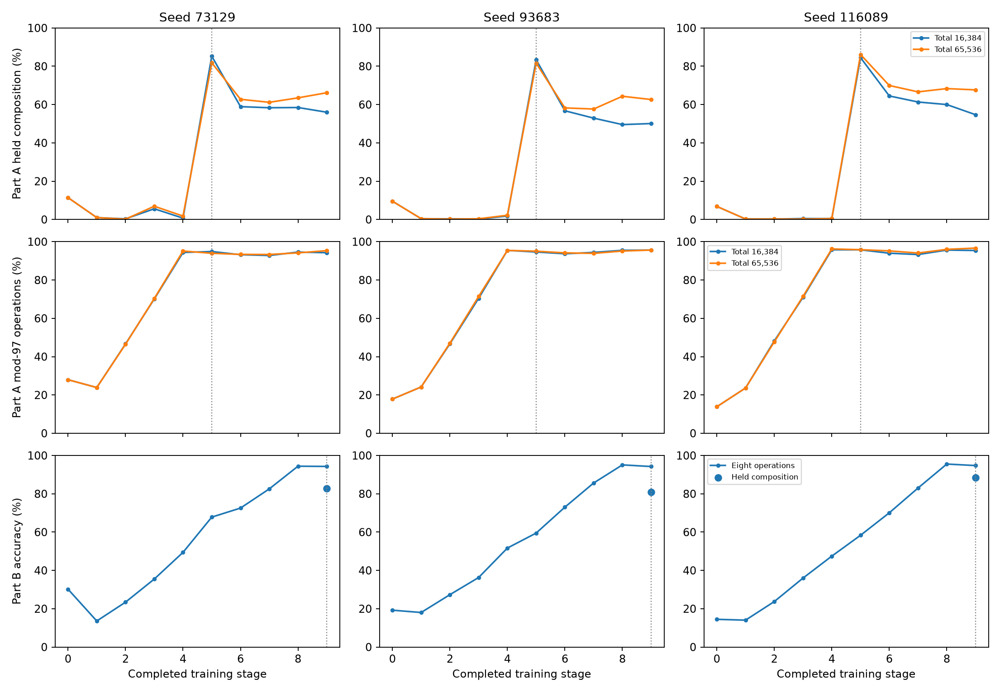

# E16-WR2 — observed replay targets and total capacity

9 of 9 scientific lives have validated receipts.

Increasing the total reservoir to 65,536 slots raised final held-composition accuracy by 10.17–12.96 percentage points across the three seeds. It still lost 15.67 / 19.00 / 18.46 points after acquisition, in seed order. Final mod-97 accuracy was 95.33% / 95.62% / 96.67%. P1 met both thresholds in 0 of 3 seeds.

At 16,384 total slots, 0 of 3 seeds met both endpoint bands against the prior per-stage reservoir. Across the two Part A capacities, 3 of 6 lives met the acquisition band against E16-W uniform replay. The larger reservoir finished with 21,351–21,516 distinct prompts. In both capacity arms the stage-end design held up to 393,216 pending records in addition to the retained reservoir.

Part B reproduced the E8 demonstration with observed answers. It changed final held-composition accuracy by +0.46 / -0.04 / +3.54 points relative to E13-A1. The eight-operation means met P4 in 3 of 3 seeds. Composition is taught last in Part B, so the endpoint measures acquisition and retention of prior operations. All three full Part B input streams matched prompt hashes independently reconstructed from the original schedule and sampler. The archived E13-A1 runs supply scores, and their original prompt streams were not recorded.

Part A uses one total reservoir of 16,384 or 65,536 slots. Replay samples uniformly from the retained observations, with origin-stage tags recorded for diagnosis. Part B retains the original 1,024-per-stage sampling schedule. All arms replay saved observed answer bytes at a one-half share after the first stage and use the sign rule, decay 0.25, batch 64 and the three standing seeds.

| Job | Post-compose held % | Final held % | Loss pp | Final held full % | Final mod-97 % | Final eight operations % | Weakest carry | Carry final % |
| --- | --- | --- | --- | --- | --- | --- | --- | --- |
| A16384_73129 | 85.2500 | 56.0000 | 29.2500 | 50.2083 | 94.2500 | 93.4375 | +- | 21.1667 |
| A16384_93683 | 83.4167 | 50.0833 | 33.3333 | 43.2083 | 95.6250 | 94.6042 | +- | 18.6667 |
| A16384_116089 | 84.5000 | 54.7083 | 29.7917 | 48.5000 | 95.4167 | 95.1250 | +- | 21.1667 |
| A65536_73129 | 81.8333 | 66.1667 | 15.6667 | 59.8333 | 95.3333 | 94.5000 | +- | 37.5000 |
| A65536_93683 | 81.6250 | 62.6250 | 19.0000 | 58.2083 | 95.6250 | 94.6042 | +- | 33.1667 |
| A65536_116089 | 86.1250 | 67.6667 | 18.4583 | 63.2083 | 96.6667 | 95.1458 | +- | 34.3333 |
| B_73129 | 82.7500 | 82.7500 | — | 80.6667 | 95.0417 | 94.2708 | +- | 66.0000 |
| B_93683 | 80.9583 | 80.9583 | — | 78.9583 | 95.8333 | 94.2292 | +- | 69.0000 |
| B_116089 | 88.5417 | 88.5417 | — | 86.6250 | 95.8750 | 94.7292 | +- | 80.6667 |

| Prediction | Passing | Evaluated | Expected |
| --- | --- | --- | --- |
| P1 | 0 | 3 | 3 |
| P2 | 0 | 3 | 3 |
| P3 | 3 | 6 | 6 |
| P4 | 3 | 3 | 3 |
| P5 | 2 | 3 | 3 |

| Prediction | Job | Pass | Measurements |
| --- | --- | --- | --- |
| P2 | A16384_73129 | False | final_held_delta_pp -6.4583, final_mod97_delta_pp -0.6250 |
| P3 | A16384_73129 | False | post_compose_delta_pp 4.3333 |
| P2 | A16384_93683 | False | final_held_delta_pp -6.9167, final_mod97_delta_pp 0.1250 |
| P3 | A16384_93683 | False | post_compose_delta_pp 5.7500 |
| P2 | A16384_116089 | False | final_held_delta_pp -10.7083, final_mod97_delta_pp -0.3750 |
| P3 | A16384_116089 | True | post_compose_delta_pp -0.8750 |
| P1 | A65536_73129 | False | held_loss_pp 15.6667, final_mod97 95.3333 |
| P3 | A65536_73129 | True | post_compose_delta_pp 0.9167 |
| P1 | A65536_93683 | False | held_loss_pp 19.0000, final_mod97 95.6250 |
| P3 | A65536_93683 | False | post_compose_delta_pp 3.9583 |
| P1 | A65536_116089 | False | held_loss_pp 18.4583, final_mod97 96.6667 |
| P3 | A65536_116089 | True | post_compose_delta_pp 0.7500 |
| P4 | B_73129 | True | final_operations_delta_pp 0.5208 |
| P5 | B_73129 | True | final_held_delta_pp 0.4583 |
| P4 | B_93683 | True | final_operations_delta_pp 0.1667 |
| P5 | B_93683 | False | final_held_delta_pp -0.0417 |
| P4 | B_116089 | True | final_operations_delta_pp 0.1458 |
| P5 | B_116089 | True | final_held_delta_pp 3.5417 |

P1 requires held loss ≤ 8 points and final mod-97 ≥ 93%. P2 requires both final endpoints within 5 points of the prior per-stage observed arm. P3 uses a two-sided 3-point acquisition band. P4 uses a two-sided 2-point band for the mean of eight operations. P5 requires a held-composition gain in [0, 5] points. Verdicts use exact panel counts before display rounding.

Part B final operation accuracy differences from E13-A1, in percentage points.

| Seed | add97 | sub97 | max97 | min97 | add73 | sub73 | max73 | min73 |
| --- | --- | --- | --- | --- | --- | --- | --- | --- |
| 73129 | -0.6667 | +2.6667 | +0.8333 | -0.5000 | +2.0000 | -0.5000 | -0.1667 | +0.5000 |
| 93683 | +0.8333 | -0.8333 | +1.3333 | +0.5000 | -0.1667 | +0.8333 | -0.6667 | -0.5000 |
| 116089 | +0.5000 | +1.1667 | -1.8333 | +0.5000 | +0.8333 | +0.6667 | -0.6667 | +0.0000 |

## Reused controls

| Role | Seed | Post-compose held % | Final held % | Final mod-97 % | Final eight operations % |
| --- | --- | --- | --- | --- | --- |
| E13_A1 | 73129 | 82.2917 | 82.2917 | 94.4583 | 93.7500 |
| E13_A1 | 93683 | 81.0000 | 81.0000 | 95.3750 | 94.0625 |
| E13_A1 | 116089 | 85.0000 | 85.0000 | 95.7917 | 94.5833 |
| WR_observed | 73129 | 79.2917 | 62.4583 | 94.8750 | 94.7083 |
| WR_observed | 93683 | 71.0417 | 57.0000 | 95.5000 | 94.8333 |
| WR_observed | 116089 | 85.1250 | 65.4167 | 95.7917 | 95.2083 |
| W_ceiling | 73129 | 90.0000 | 90.5000 | 95.9167 | 95.0833 |
| W_ceiling | 93683 | 90.1250 | 90.7500 | 96.2500 | 94.8750 |
| W_ceiling | 116089 | 90.4167 | 91.8750 | 97.0000 | 95.6667 |
| W_uniform | 73129 | 80.9167 | 35.3333 | 77.0833 | 84.6250 |
| W_uniform | 93683 | 77.6667 | 31.2500 | 79.2500 | 85.2917 |
| W_uniform | 116089 | 85.3750 | 37.2917 | 84.6250 | 88.4792 |

The score CSV records every stage and scored panel, including individual operations, held pairs, within-pair scores and intermediate and full scratchpad accuracy. The exposure ledger records retained slots, distinct prompts, transient pending observations and realized draws by origin stage. Replay target agreement measures byte equality with the stored observed answer. [Score CSV](E16WR2_ALL_SCORES.csv) · [Exposure CSV](E16WR2_EXPOSURES.csv) · [Exposure ledger](E16WR2_EXPOSURES.json)

The equal-numeric-capacity P2 comparison changes both retained memory and sampling. The earlier per-stage arm could retain 147,456 slots across nine stages. Pending observations add transient memory to the new total reservoir before they become eligible at the stage boundary. These synthetic tasks use a staged training schedule and the existing Store. The cell and window results use different schedules, representations and tasks.

Each life has 470,801 trainable weights and the existing 65,536-key Store. Worker RSS includes the independent observation map used to check replay targets. The historical comparators, births and WR full-default reproduction are reused. WR2 budgets three short qualification cycles and zero additional full-profile lives. The locked configuration saves scores, traces and provenance, with final model weight export disabled. [Cost ledger](E16WR2_COSTS.json)

All 14,745,600 replay draws across the nine lives matched previously observed answer bytes.

The campaign took 28.47 minutes of controller wall time and 3.4059 CPU-hours across reaped child processes.

The technical cycles used 4.89 child CPU seconds and 5.57 wall seconds. Scientific worker timers sum to 3.4008 CPU-hours and exclude imports and metadata writing. Controller CPU was 0.93 seconds. The raw scientific receipt, metadata, replay ledger, job and log files total 276,502 bytes.

| Job | Worker CPU seconds | Job wall seconds | Peak RSS | RSS units |
| --- | --- | --- | --- | --- |
| A16384_73129 | 1428.41 | 1662.46 | 508,297,216 | bytes |
| A16384_93683 | 1445.85 | 1682.41 | 511,541,248 | bytes |
| A16384_116089 | 1443.51 | 1682.35 | 516,374,528 | bytes |
| A65536_73129 | 1460.80 | 1702.29 | 512,294,912 | bytes |
| A65536_93683 | 1458.84 | 1692.21 | 506,871,808 | bytes |
| A65536_116089 | 1463.70 | 1702.15 | 513,638,400 | bytes |
| B_73129 | 1182.41 | 1391.67 | 415,547,392 | bytes |
| B_93683 | 1181.15 | 1391.59 | 420,036,608 | bytes |
| B_116089 | 1178.22 | 1391.49 | 420,003,840 | bytes |

