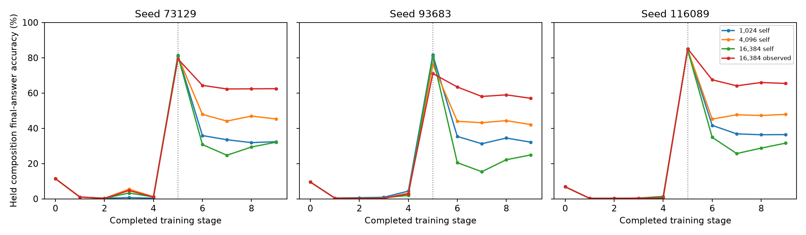

# E16-WR — bounded stage reservoirs and replay targets

Status: COMPLETE_VERIFIED; 12/12 scientific lives have complete validated receipts. No incomplete life is scored as a final result.

Four arms: self-generated replay at1,024/4,096/16,384slots per stage and observed-answer replay at16,384. Three seeds each. Nine stage strata,57344updates,sign rule,decay0.25,batch64. Comparators and births are reused, not rerun. One full default-profile reproduction is charged separately.

The largest pair must match prompt-input hashes and every reservoir/draw snapshot. Observed answers are saved with current presented examples; neither arm invents new observations. The observed treatment changes replay targets throughout life, including operations, so it does not isolate only late composition errors.

|Capacity|Targets|Seed|Post-compose held|Final held|Loss pp|Final full|Final old97|
|---|---|---|---|---|---|---|---|
|1024|self|73129|81.3750|32.3750|49.0000|22.6250|83.7917|
|1024|self|93683|81.6250|32.1250|49.5000|24.5833|85.2917|
|1024|self|116089|84.6667|36.4167|48.2500|28.5417|85.5417|
|4096|self|73129|80.7083|45.2917|35.4167|37.5833|77.3750|
|4096|self|93683|76.2917|42.0833|34.2083|32.8750|82.3333|
|4096|self|116089|84.6250|47.8750|36.7500|39.2500|81.5833|
|16384|observed|73129|79.2917|62.4583|16.8333|57.2917|94.8750|
|16384|observed|93683|71.0417|57.0000|14.0417|53.0000|95.5000|
|16384|observed|116089|85.1250|65.4167|19.7083|60.3333|95.7917|
|16384|self|73129|81.0000|32.0833|48.9167|14.0000|70.4583|
|16384|self|93683|80.5000|24.8750|55.6250|7.2083|77.4167|
|16384|self|116089|84.3750|31.5833|52.7917|13.5833|74.3750|

|Seed|Prediction|Pass|Exact values|
|---|---|---|---|
|73129|P1|False|{'finals': [32.375, 45.29166666666667, 32.083333333333336], 'largest_loss': 48.916666666666664, 'reused_loss': 45.583333333333336}|
|73129|P2|False|70.45833333333333|
|73129|P3|False|{'held_delta': -2.9583333333333357, 'old97_delta': 6.708333333333343}|
|73129|P4_1024_self|True|0.4583333333333286|
|73129|P4_4096_self|True|-0.2083333333333428|
|73129|P4_16384_self|True|0.0833333333333286|
|73129|P4_16384_observed|True|-1.625|
|73129|P5|True|{'self_loss': 48.916666666666664, 'observed_loss': 16.833333333333336, 'loss_reduction_pp': 32.08333333333333}|
|93683|P1|False|{'finals': [32.125, 42.08333333333333, 24.875], 'largest_loss': 55.625, 'reused_loss': 46.41666666666666}|
|93683|P2|False|77.41666666666667|
|93683|P3|False|{'held_delta': 0.875, 'old97_delta': 6.041666666666657}|
|93683|P4_1024_self|False|3.958333333333343|
|93683|P4_4096_self|True|-1.375|
|93683|P4_16384_self|True|2.833333333333343|
|93683|P4_16384_observed|False|-6.624999999999986|
|93683|P5|True|{'self_loss': 55.625, 'observed_loss': 14.041666666666671, 'loss_reduction_pp': 41.58333333333333}|
|116089|P1|False|{'finals': [36.416666666666664, 47.875, 31.583333333333336], 'largest_loss': 52.791666666666664, 'reused_loss': 48.083333333333336}|
|116089|P2|False|74.375|
|116089|P3|True|{'held_delta': -0.875, 'old97_delta': 0.9166666666666572}|
|116089|P4_1024_self|True|-0.7083333333333428|
|116089|P4_4096_self|True|-0.75|
|116089|P4_16384_self|True|-1.0|
|116089|P4_16384_observed|True|-0.25|
|116089|P5|True|{'self_loss': 52.791666666666664, 'observed_loss': 19.70833333333333, 'loss_reduction_pp': 33.083333333333336}|

Full per-stage operation/pair/within and full-scratchpad curves: E16WR_CURVES.csv and E16WR_ALL_SCORES.csv. Per-stage actual draw counts, reservoir support and replay target errors: E16WR_EXPOSURES.json. Raw receipts retain every source score.

## Reused controls

|Role|Seed|Final held|Final old97|New run?|
|---|---|---|---|---|
|C_uni|73129|35.3333|77.0833|No|
|C_uni|93683|31.2500|79.2500|No|
|C_uni|116089|37.2917|84.6250|No|
|D_ceiling|73129|90.5000|95.9167|No|
|D_ceiling|93683|90.7500|96.2500|No|
|D_ceiling|116089|91.8750|97.0000|No|

## Costs and limits

E16WR_COSTS.json gives measured life CPU from before model construction through final scoring (excluding imports and metadata writing), controller wall and observed peakRSS with platform units. E16WR_STATUS.json gives exact CPU of reaped child processes plus controller CPU; technical cost is separate in E16WR_TECHNICAL_JOB.json. Reused birth/control training costs are historical and are not counted as new.

This is a synthetic development experiment. Per-stage caps are not a total bound for an unlimited number of stages. AlgorithmR admits duplicate presentations; capacity is not guaranteed distinct coverage. The window and cell studies differ in strata, data and replay targets, preventing a cell-only causal comparison. No new mechanism or autonomous learning is established solely by these scores.

## Final findings

|Prediction|Passes|Total|
|---|---|---|
|P1|0|3|
|P2|0|3|
|P3|1|3|
|P5|3|3|
|P4|10|12|

At self-target capacity16,384, final held composition is 32.08 / 24.88 / 31.58%; observed-target finals are 62.46 / 57.00 / 65.42%. Larger self-target reservoirs are not a monotonic retention repair in these runs. The observed-target comparison must be read through the matched input/coverage checks and its per-seed loss differences, not as a new architecture result.

|Seed|Self loss|Observed loss|Loss reduction pp|P5≥10pp|
|---|---|---|---|---|
|73129|48.9167|16.8333|32.0833|True|
|93683|55.6250|14.0417|41.5833|True|
|116089|52.7917|19.7083|33.0833|True|

All three largest-capacity pairs match actual prompt-order hashes and all nine stage reservoir and draw snapshots exactly. Observed targets were saved with presented examples. This identifies the effect of replacing self-generated replay targets with observed targets at this capacity and schedule, including downstream changes in Store and earlier acquisition. It does not isolate a late-composition-only effect, establish a global capacity optimum, or prove autonomous learning.

Campaign child CPU: 4.4383 hours, including the technical cycles and full default reproduction; controller CPU 1.332s. Campaign wall 46.66min from controller start, excluding prior waiting. Actual peakRSS is recorded per worker in E16WR_FINAL_COSTS.json. Initial forecasts are retained as forecasts, not rewritten to match measured cost.

No final scientific model/optimizer checkpoints were saved under the locked settings. Exact source, hashes, commands, raw receipts, scores, diagnostics and technical trajectory hashes are retained; do not describe these as a complete resumable checkpoint bundle.

Observed-target replay still loses14.04–19.71 percentage points after composition learning; it does not solve retention. Final held accuracy improves by30.38/32.12/33.83pp versus matched largest self-target arms. The loss-reduction endpoint also reflects different acquisition levels, particularly seed93683; use the full endpoint/acquisition tables rather than interpreting P5 as final-accuracy gain.

