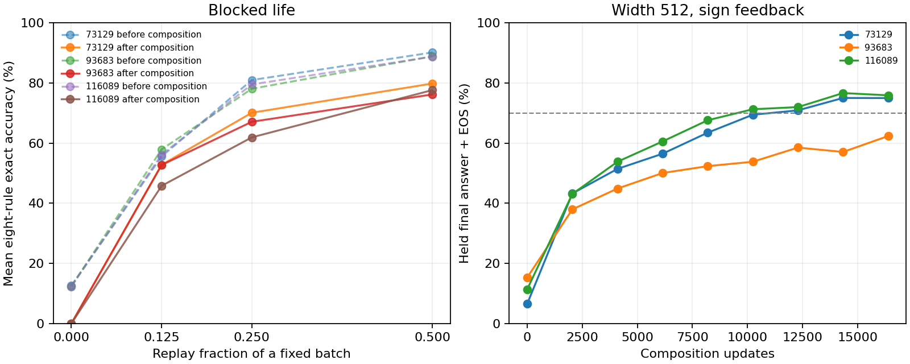

# E9 price of persistence

Campaign status **complete**. All 15 new jobs exited successfully; no part was stopped.

All 15 new histories and the full default-profile reproduction completed. The 1/4 replay share lost 9.17–10.77 points of mean retention before composition versus 1/2, missing the five-point prediction. Interleaving without replay retained 91.19–92.06% while all operations remained in the stream, then fell to 0% on standalone-operation outputs after the composition phase. Width 512 at double dose reached 74.96%, 62.33% and 75.88% mean held final-answer accuracy. Two seeds crossed 70%; the all-seed prediction missed.

The source is the consolidated branch at 2fc1ef2, and the model has 470,801 parameters. Predictions and exact commands were recorded before the first gradient step in [E9_PREDICTIONS.md](E9_PREDICTIONS.md). The unchanged default path reproduced all scientific scores and losses in a complete C life, excluding timing fields. The reproduced profile receipt is exp45/e9_profile_life_C_73129.json; the archived E8 receipt is preserved byte for byte. [Source and birth lock](E9_LOCK.json) · [Independent result recount](E9_VERIFICATION.json).

| Schedule | Replay | Seed | Mean eight rules before composition | After composition | Held composition mean |
| --- | --- | --- | ---: | ---: | ---: |
| blocked | 1/8 | 73129 | 55.54% | 52.77% | 54.46% |
| blocked | 1/8 | 93683 | 57.90% | 52.71% | 49.00% |
| blocked | 1/8 | 116089 | 56.19% | 45.77% | 41.58% |
| blocked | 1/4 | 73129 | 80.96% | 70.08% | 61.71% |
| blocked | 1/4 | 93683 | 78.06% | 67.08% | 59.38% |
| blocked | 1/4 | 116089 | 79.50% | 61.90% | 47.12% |
| blocked | 1/2 | 73129 | 90.13% | 79.79% | 54.92% |
| blocked | 1/2 | 93683 | 88.83% | 76.17% | 51.67% |
| blocked | 1/2 | 116089 | 88.73% | 77.60% | 48.29% |
| blocked | 0 | 73129 | 12.60% | 0.00% | 17.96% |
| blocked | 0 | 93683 | 12.35% | 0.00% | 25.62% |
| blocked | 0 | 116089 | 12.33% | 0.00% | 22.79% |
| interleaved | 1/2 | 73129 | 91.90% | 76.48% | 50.42% |
| interleaved | 1/2 | 93683 | 91.52% | 74.65% | 43.62% |
| interleaved | 1/2 | 116089 | 90.52% | 77.21% | 48.12% |
| interleaved | 0 | 73129 | 91.81% | 0.00% | 65.38% |
| interleaved | 0 | 93683 | 92.06% | 0.00% | 69.79% |
| interleaved | 0 | 116089 | 91.19% | 0.00% | 68.46% |

## Part C

Mean is over the four held operator-pair panels. Final-answer accuracy includes the model’s own EOS. The last-minus-previous change covers updates 14,336–16,384. Two seeds passed the 70% target, and seed 93683 missed while still rising.

| Seed | Held pair means at endpoint | Within | Final minus previous held mean |
| --- | ---: | ---: | ---: |
| 73129 | 74.96% | 77.67% | -0.04 points |
| 93683 | 62.33% | 69.17% | +5.29 points |
| 116089 | 75.88% | 79.17% | -0.75 points |

## Prediction checks

- A quarter, seed 73129 · stage-8 mean delta -9.17 points, carry erosion 16.88 vs 14.75 points, prediction False.
- A eighth, seed 73129 · earliest-four mean drop 36.54 points, prediction True.
- B no replay, seed 73129 · weakest per-operation delta -1.33, carry erosion 87.46 points, prediction False.
- A quarter, seed 93683 · stage-8 mean delta -10.77 points, carry erosion 16.67 vs 19.79 points, prediction False.
- A eighth, seed 93683 · earliest-four mean drop 33.21 points, prediction True.
- B no replay, seed 93683 · weakest per-operation delta -1.17, carry erosion 87.92 points, prediction False.
- A quarter, seed 116089 · stage-8 mean delta -9.23 points, carry erosion 27.88 vs 19.33 points, prediction False.
- A eighth, seed 116089 · earliest-four mean drop 36.62 points, prediction True.
- B no replay, seed 116089 · weakest per-operation delta -2.50, carry erosion 86.96 points, prediction False.

## Archived backprop ceiling

The nine blocked A, C and D histories are historical results reused from E8; one C life was fully reproduced for the default-path and profiling check. All lower-share, interleaved and Part C histories were newly executed.

- Seed 73129 · mean operations at stage 8 95.35%, after composition 94.17%. Receipt exp45/e8_life_D_73129.json.
- Seed 93683 · mean operations at stage 8 96.27%, after composition 95.75%. Receipt exp45/e8_life_D_93683.json.
- Seed 116089 · mean operations at stage 8 96.21%, after composition 93.94%. Receipt exp45/e8_life_D_116089.json.

## blocked, replay 1/8, seed 73129

| Operation | Before composition | After composition |
| --- | ---: | ---: |
| add97 | 16.33% | 47.50% |
| sub97 | 14.33% | 3.33% |
| max97 | 93.67% | 82.67% |
| min97 | 93.67% | 84.17% |
| add73 | 15.83% | 25.50% |
| sub73 | 16.50% | 6.33% |
| max73 | 95.00% | 86.17% |
| min73 | 99.00% | 86.50% |

Composition +- · final 178/600, full output 161/600.

Composition -+ · final 208/600, full output 192/600.

Composition >< · final 465/600, full output 431/600.

Composition <> · final 456/600, full output 427/600.

Composition within · final 378/600, full output 348/600.

## blocked, replay 1/8, seed 93683

| Operation | Before composition | After composition |
| --- | ---: | ---: |
| add97 | 19.67% | 49.33% |
| sub97 | 22.50% | 6.17% |
| max97 | 93.67% | 84.50% |
| min97 | 94.67% | 87.67% |
| add73 | 14.17% | 21.50% |
| sub73 | 23.67% | 5.50% |
| max73 | 96.17% | 86.00% |
| min73 | 98.67% | 81.00% |

Composition +- · final 112/600, full output 99/600.

Composition -+ · final 120/600, full output 109/600.

Composition >< · final 502/600, full output 466/600.

Composition <> · final 442/600, full output 417/600.

Composition within · final 345/600, full output 325/600.

## blocked, replay 1/8, seed 116089

| Operation | Before composition | After composition |
| --- | ---: | ---: |
| add97 | 16.83% | 10.33% |
| sub97 | 20.67% | 1.83% |
| max97 | 87.83% | 86.33% |
| min97 | 91.67% | 86.00% |
| add73 | 15.17% | 6.67% |
| sub73 | 25.00% | 4.17% |
| max73 | 94.50% | 87.33% |
| min73 | 97.83% | 83.50% |

Composition +- · final 59/600, full output 49/600.

Composition -+ · final 83/600, full output 71/600.

Composition >< · final 424/600, full output 394/600.

Composition <> · final 432/600, full output 396/600.

Composition within · final 292/600, full output 273/600.

## blocked, replay 1/4, seed 73129

| Operation | Before composition | After composition |
| --- | ---: | ---: |
| add97 | 69.00% | 77.17% |
| sub97 | 65.50% | 40.50% |
| max97 | 94.50% | 89.17% |
| min97 | 96.33% | 92.67% |
| add73 | 63.00% | 41.33% |
| sub73 | 65.67% | 36.67% |
| max73 | 95.17% | 90.00% |
| min73 | 98.50% | 93.17% |

Composition +- · final 243/600, full output 228/600.

Composition -+ · final 276/600, full output 257/600.

Composition >< · final 476/600, full output 432/600.

Composition <> · final 486/600, full output 447/600.

Composition within · final 403/600, full output 375/600.

## blocked, replay 1/4, seed 93683

| Operation | Before composition | After composition |
| --- | ---: | ---: |
| add97 | 59.83% | 77.67% |
| sub97 | 67.67% | 33.00% |
| max97 | 94.50% | 92.00% |
| min97 | 97.17% | 91.33% |
| add73 | 56.83% | 32.83% |
| sub73 | 56.83% | 31.00% |
| max73 | 94.17% | 90.17% |
| min73 | 97.50% | 88.67% |

Composition +- · final 193/600, full output 178/600.

Composition -+ · final 265/600, full output 241/600.

Composition >< · final 496/600, full output 466/600.

Composition <> · final 471/600, full output 443/600.

Composition within · final 392/600, full output 377/600.

## blocked, replay 1/4, seed 116089

| Operation | Before composition | After composition |
| --- | ---: | ---: |
| add97 | 63.00% | 64.50% |
| sub97 | 69.17% | 22.33% |
| max97 | 93.17% | 89.00% |
| min97 | 94.67% | 88.33% |
| add73 | 57.33% | 32.67% |
| sub73 | 65.67% | 24.17% |
| max73 | 96.00% | 86.83% |
| min73 | 97.00% | 87.33% |

Composition +- · final 125/600, full output 106/600.

Composition -+ · final 160/600, full output 144/600.

Composition >< · final 422/600, full output 387/600.

Composition <> · final 424/600, full output 379/600.

Composition within · final 322/600, full output 298/600.

## blocked, replay 1/2, seed 73129

| Operation | Before composition | After composition |
| --- | ---: | ---: |
| add97 | 86.50% | 83.33% |
| sub97 | 84.67% | 68.00% |
| max97 | 96.67% | 89.33% |
| min97 | 96.33% | 90.33% |
| add73 | 80.00% | 64.83% |
| sub73 | 83.17% | 59.17% |
| max73 | 95.83% | 90.50% |
| min73 | 97.83% | 92.83% |

Composition +- · final 189/600, full output 174/600.

Composition -+ · final 225/600, full output 202/600.

Composition >< · final 442/600, full output 374/600.

Composition <> · final 462/600, full output 422/600.

Composition within · final 364/600, full output 335/600.

## blocked, replay 1/2, seed 93683

| Operation | Before composition | After composition |
| --- | ---: | ---: |
| add97 | 86.00% | 81.00% |
| sub97 | 83.33% | 64.83% |
| max97 | 96.33% | 93.17% |
| min97 | 97.67% | 92.50% |
| add73 | 77.67% | 49.00% |
| sub73 | 75.00% | 48.00% |
| max73 | 97.17% | 89.50% |
| min73 | 97.50% | 91.33% |

Composition +- · final 135/600, full output 122/600.

Composition -+ · final 197/600, full output 179/600.

Composition >< · final 460/600, full output 408/600.

Composition <> · final 448/600, full output 392/600.

Composition within · final 348/600, full output 328/600.

## blocked, replay 1/2, seed 116089

| Operation | Before composition | After composition |
| --- | ---: | ---: |
| add97 | 87.00% | 83.33% |
| sub97 | 85.50% | 60.17% |
| max97 | 94.00% | 91.83% |
| min97 | 97.00% | 93.67% |
| add73 | 76.33% | 50.17% |
| sub73 | 80.67% | 58.50% |
| max73 | 94.17% | 91.67% |
| min73 | 95.17% | 91.50% |

Composition +- · final 100/600, full output 87/600.

Composition -+ · final 173/600, full output 155/600.

Composition >< · final 423/600, full output 364/600.

Composition <> · final 463/600, full output 418/600.

Composition within · final 309/600, full output 281/600.

## blocked, replay 0, seed 73129

| Operation | Before composition | After composition |
| --- | ---: | ---: |
| add97 | 0.00% | 0.00% |
| sub97 | 0.00% | 0.00% |
| max97 | 0.67% | 0.00% |
| min97 | 1.00% | 0.00% |
| add73 | 0.00% | 0.00% |
| sub73 | 0.00% | 0.00% |
| max73 | 0.00% | 0.00% |
| min73 | 99.17% | 0.00% |

Composition +- · final 15/600, full output 4/600.

Composition -+ · final 20/600, full output 2/600.

Composition >< · final 188/600, full output 139/600.

Composition <> · final 208/600, full output 141/600.

Composition within · final 123/600, full output 108/600.

## blocked, replay 0, seed 93683

| Operation | Before composition | After composition |
| --- | ---: | ---: |
| add97 | 0.00% | 0.00% |
| sub97 | 0.00% | 0.00% |
| max97 | 0.00% | 0.00% |
| min97 | 0.00% | 0.00% |
| add73 | 0.00% | 0.00% |
| sub73 | 0.00% | 0.00% |
| max73 | 0.00% | 0.00% |
| min73 | 98.83% | 0.00% |

Composition +- · final 14/600, full output 4/600.

Composition -+ · final 27/600, full output 9/600.

Composition >< · final 298/600, full output 203/600.

Composition <> · final 276/600, full output 211/600.

Composition within · final 182/600, full output 153/600.

## blocked, replay 0, seed 116089

| Operation | Before composition | After composition |
| --- | ---: | ---: |
| add97 | 0.00% | 0.00% |
| sub97 | 0.00% | 0.00% |
| max97 | 0.00% | 0.00% |
| min97 | 0.00% | 0.00% |
| add73 | 0.00% | 0.00% |
| sub73 | 0.00% | 0.00% |
| max73 | 0.00% | 0.00% |
| min73 | 98.67% | 0.00% |

Composition +- · final 21/600, full output 7/600.

Composition -+ · final 15/600, full output 0/600.

Composition >< · final 243/600, full output 189/600.

Composition <> · final 268/600, full output 205/600.

Composition within · final 170/600, full output 146/600.

## interleaved, replay 1/2, seed 73129

| Operation | Before composition | After composition |
| --- | ---: | ---: |
| add97 | 88.17% | 76.00% |
| sub97 | 88.33% | 61.67% |
| max97 | 96.83% | 91.17% |
| min97 | 95.83% | 94.33% |
| add73 | 86.50% | 47.33% |
| sub73 | 87.00% | 55.33% |
| max73 | 95.83% | 92.67% |
| min73 | 96.67% | 93.33% |

Composition +- · final 122/600, full output 109/600.

Composition -+ · final 132/600, full output 116/600.

Composition >< · final 470/600, full output 414/600.

Composition <> · final 486/600, full output 425/600.

Composition within · final 322/600, full output 296/600.

## interleaved, replay 1/2, seed 93683

| Operation | Before composition | After composition |
| --- | ---: | ---: |
| add97 | 91.67% | 80.17% |
| sub97 | 89.50% | 57.33% |
| max97 | 95.67% | 92.33% |
| min97 | 96.67% | 94.67% |
| add73 | 84.00% | 45.17% |
| sub73 | 84.00% | 44.67% |
| max73 | 95.00% | 90.67% |
| min73 | 95.67% | 92.17% |

Composition +- · final 93/600, full output 74/600.

Composition -+ · final 92/600, full output 79/600.

Composition >< · final 417/600, full output 372/600.

Composition <> · final 445/600, full output 396/600.

Composition within · final 300/600, full output 279/600.

## interleaved, replay 1/2, seed 116089

| Operation | Before composition | After composition |
| --- | ---: | ---: |
| add97 | 87.50% | 79.83% |
| sub97 | 89.17% | 64.17% |
| max97 | 97.50% | 92.33% |
| min97 | 95.83% | 92.50% |
| add73 | 81.17% | 49.00% |
| sub73 | 81.33% | 55.67% |
| max73 | 95.50% | 92.83% |
| min73 | 96.17% | 91.33% |

Composition +- · final 88/600, full output 63/600.

Composition -+ · final 135/600, full output 109/600.

Composition >< · final 467/600, full output 412/600.

Composition <> · final 465/600, full output 426/600.

Composition within · final 323/600, full output 290/600.

## interleaved, replay 0, seed 73129

| Operation | Before composition | After composition |
| --- | ---: | ---: |
| add97 | 89.00% | 0.00% |
| sub97 | 89.00% | 0.00% |
| max97 | 96.00% | 0.00% |
| min97 | 96.33% | 0.00% |
| add73 | 86.17% | 0.00% |
| sub73 | 85.67% | 0.00% |
| max73 | 95.83% | 0.00% |
| min73 | 96.50% | 0.00% |

Composition +- · final 272/600, full output 254/600.

Composition -+ · final 257/600, full output 239/600.

Composition >< · final 524/600, full output 499/600.

Composition <> · final 516/600, full output 499/600.

Composition within · final 417/600, full output 396/600.

## interleaved, replay 0, seed 93683

| Operation | Before composition | After composition |
| --- | ---: | ---: |
| add97 | 92.17% | 0.00% |
| sub97 | 90.00% | 0.00% |
| max97 | 95.33% | 0.00% |
| min97 | 97.00% | 0.00% |
| add73 | 85.00% | 0.00% |
| sub73 | 84.50% | 0.00% |
| max73 | 96.00% | 0.00% |
| min73 | 96.50% | 0.00% |

Composition +- · final 316/600, full output 293/600.

Composition -+ · final 324/600, full output 314/600.

Composition >< · final 514/600, full output 496/600.

Composition <> · final 521/600, full output 496/600.

Composition within · final 448/600, full output 429/600.

## interleaved, replay 0, seed 116089

| Operation | Before composition | After composition |
| --- | ---: | ---: |
| add97 | 90.50% | 0.00% |
| sub97 | 91.83% | 0.00% |
| max97 | 96.50% | 0.00% |
| min97 | 94.50% | 0.00% |
| add73 | 82.50% | 0.00% |
| sub73 | 83.00% | 0.00% |
| max73 | 95.33% | 0.00% |
| min73 | 95.33% | 0.00% |

Composition +- · final 322/600, full output 295/600.

Composition -+ · final 294/600, full output 272/600.

Composition >< · final 513/600, full output 495/600.

Composition <> · final 514/600, full output 497/600.

Composition within · final 447/600, full output 419/600.

## Part C, seed 73129

- +- · final 373/600, full output 351/600.
- -+ · final 372/600, full output 359/600.
- >< · final 519/600, full output 500/600.
- <> · final 535/600, full output 519/600.
- within · final 466/600, full output 454/600.

## Part C, seed 93683

- +- · final 250/600, full output 223/600.
- -+ · final 255/600, full output 236/600.
- >< · final 511/600, full output 489/600.
- <> · final 480/600, full output 454/600.
- within · final 415/600, full output 393/600.

## Part C, seed 116089

- +- · final 380/600, full output 358/600.
- -+ · final 394/600, full output 370/600.
- >< · final 518/600, full output 490/600.
- <> · final 529/600, full output 504/600.
- within · final 475/600, full output 458/600.

## Measured execution costs

- Full default profile · 809.71 wall seconds and 778.74 recorded CPU seconds.
- Fifteen new histories plus profiling · 11053.20 recorded training/evaluation CPU seconds (3.07 hours), summed process wall time 11204.07 seconds.
- Elapsed campaign time · 46.17 minutes, with at most six single-threaded workers.
- CPU clocks inherit the original scripts’ placement after setup and initial scoring, so the sum excludes that work. Process wall times include it. Technical parity checks and historical training are additional costs.
- Reused development checkpoints · six files totaling 11,319,497 bytes. No new development training was needed. Model weight tensors occupy 1,883,204 bytes and Adam moments 3,766,408 bytes per live learner, before gradients, activations, store and replay buffers. Peak RSS was not measured.

## Interpretation and limits

Replay share changes both old-item rehearsal and new-item exposure at a fixed batch and update budget. The measured trade-off applies to that budget. Quarter replay improved held composition over half replay in two seeds but lost substantial standalone-operation retention; eighth replay damaged early arithmetic strongly. Interleaving preserves the eight rules during their joint stage, yet subsequent composition-only training erases standalone responses without replay. This localizes that failure to the later distribution change. All reported zeros are exact own-output scores on the original single-operation prompts. They do not by themselves establish that every internal arithmetic representation was erased.

Interleaving uses eight new samples per task in a full batch, four per task at half replay. Its replay buffer contains only already-delivered prompts, capped at 1,024 distinct prompts per task. This is the declared interleaved extension; blocked defaults preserve their original sampling.

The half-replay final mean of 76–80% conceals weaker individual rules. The weakest single-operation score is only 48–59%, and the four add/sub operations average about 61–69%. The per-operation tables above retain this distinction. In Part C, the full emitted scratchpad has mean exact accuracy 72.04%, 58.42% and 71.75%; the final-answer-plus-EOS endpoint is higher. Part C is isolated composition training and makes no combined-lifetime retention claim.
