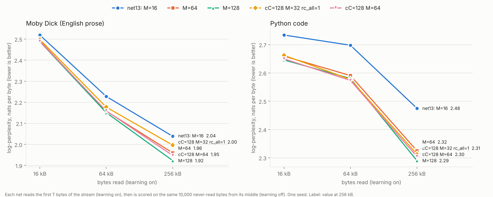

# Data scaling: log-perplexity vs bytes read (24 Nov 2026)

Each net reads the first T bytes of Moby Dick or of the repository's Python code (learning on), then is scored on the same 10,000 never-read bytes from the middle of the stream (learning off). Seed 1. Learned-temperature readout (t26_calib.py). Cells: log-perplexity (nats/byte) / bits / right share. Sources: datascale_results_{a,b,c,d}.jsonl.

Chinese-labelled version: DATASCALE_zh.png

### moby

| net | T=16k log-perplexity (nats/byte) / bits / right | T=64k log-perplexity (nats/byte) / bits / right | T=256k log-perplexity (nats/byte) / bits / right |
|---|---|---|---|
| E4 | 2.498 / 3.604 / 0.403 | 2.177 / 3.141 / 0.448 | 1.996 / 2.880 / 0.475 |
| E6 | 2.489 / 3.591 / 0.409 | 2.159 / 3.115 / 0.455 | 1.948 / 2.810 / 0.487 |
| M128 | 2.488 / 3.590 / 0.412 | 2.151 / 3.103 / 0.454 | 1.923 / 2.774 / 0.496 |
| M16 | 2.519 / 3.634 / 0.399 | 2.228 / 3.214 / 0.433 | 2.038 / 2.941 / 0.451 |
| M64 | 2.491 / 3.595 / 0.411 | 2.158 / 3.113 / 0.454 | 1.960 / 2.827 / 0.482 |

### code

| net | T=16k log-perplexity (nats/byte) / bits / right | T=64k log-perplexity (nats/byte) / bits / right | T=256k log-perplexity (nats/byte) / bits / right |
|---|---|---|---|
| E4 | 2.662 / 3.841 / 0.426 | 2.577 / 3.718 / 0.455 | 2.313 / 3.337 / 0.491 |
| E6 | 2.650 / 3.823 / 0.432 | 2.574 / 3.713 / 0.456 | 2.304 / 3.324 / 0.506 |
| M128 | 2.646 / 3.817 / 0.431 | 2.580 / 3.723 / 0.457 | 2.290 / 3.304 / 0.506 |
| M16 | 2.734 / 3.944 / 0.406 | 2.698 / 3.892 / 0.429 | 2.475 / 3.571 / 0.452 |
| M64 | 2.659 / 3.837 / 0.430 | 2.591 / 3.738 / 0.454 | 2.325 / 3.354 / 0.498 |

stream lengths seen: [('code', 32006209), ('moby', 1242990)]

Reading:
- More data lowers log-perplexity for every net. On Moby it falls by about 0.5 nats/byte from 16k to 256k (net13 2.52 to 2.04; M=128 2.49 to 1.92).
- The gap between the smallest net (net13, M=16) and the widest grows with data:
  - Moby: 0.03 at 16k, 0.08 at 64k, 0.12 at 256k;
  - code: 0.09, 0.12, 0.19.
- At 16k the widths are almost equal, so the earlier finding that width does not help prediction came from too little data.
- Among the wide nets (M=64, M=128, cC=128 M=64, cC=128 M=32 rc_all=1), the differences are small (≤ 0.07 nats).
- One seed only; the moby seed spread at 16k is about ±0.007 in right share.
