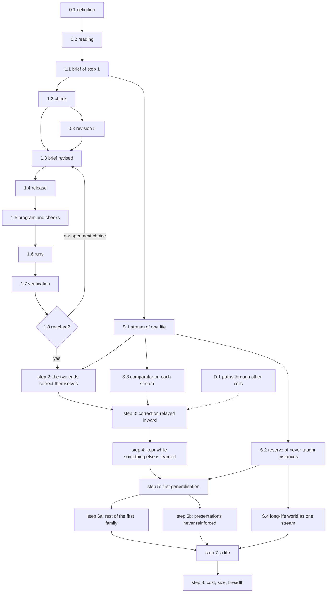

# Task graph for the route to end-to-end persistent learning with generalisation (19 November 2026, 00:13 UTC, version 1)

By the outside reviewer, for Mr. Xu and the coordinator. This file turns the roadmap (`ROADMAP_TO_END_TO_END_PERSISTENT_LEARNING_20261118.md`, draft 3) into tasks that can be handed one at a time to an agent or a worker session that knows nothing but what the task names. It starts nothing; releases are the coordinator's.

## 1. How to read it

Each task has an identifier, what is to be produced, what it depends on, who does it, and when it is done. **Writer** and **checker** are agents that read and write documents only; they are never the same agent for one document. **Worker** is a session that writes a program and runs it, only after the coordinator's release. **Coordinator** releases, verifies and decides. A task is *ready* when everything it depends on is done.

Status words: done; running; ready; waiting (for the tasks named).

## 2. Documents every task starts from

| | File (in `COORDINATION_20261117/` unless a path is given) | What it is |
|---|---|---|
| A | `minifly_b/package/DOCS/MINIFLY_OBJECTIVE_CONTRACT.md` | The goal and the levels of evidence E0 to E4 |
| B | `WHAT_A_NEURON_HAS_20261118.md`, sections 7 to 17 | Mr. Xu's words; they govern everything else |
| C | `ROADMAP_TO_END_TO_END_PERSISTENT_LEARNING_20261118.md` | The steps, their dependencies and the conditions that hold at every step |
| D | `THE_TISSUE_DEFINED_REVISION_4_20261118.md` with errata E1 to E9 in `FIFTH_READING_OF_THE_TISSUE_DEFINED_20261118.md` | The definition of the tissue; a program is this and nothing else |
| E | `THE_EARLIER_RECORD_PLACED_ON_THE_ROADMAP_20261118.md` | What the record already holds near each step (an agent's reading, not re-checked) |

## 3. The tasks

### Group 0: the definition (step 0 of the roadmap)

| Id | Task | Depends on | Who | Done when | Status |
|---|---|---|---|---|---|
| 0.1 | Definition of the tissue, sentence by sentence | B | writer | written | done (revision 4) |
| 0.2 | Reading of the definition by another agent | 0.1 | checker | verdict "passes" | done (fifth reading: passes with nine errata) |
| 0.3 | Revision 5: the nine errata folded in, section 17 of B entered as an open choice, and any change that task 1.2 finds necessary | 0.2, 1.2 | writer, then checker | one file that needs no errata table | done (`THE_TISSUE_DEFINED_REVISION_5_20261119.md`; read against the brief by the checker of 1.2, not yet by a reader of its own) |

### Group 1: the tissue reads the stream and stays informative (step 1, level E0)

| Id | Task | Depends on | Who | Done when | Status |
|---|---|---|---|---|---|
| 1.1 | Brief of step 1 | 0.2 | writer | `TASK_STEP_1_THE_TISSUE_READS_THE_STREAM_20261118.md` | done, unchecked |
| 1.2 | Check of the brief, with a judgment on what is visible on paper before any run (the writer expects the step not to be reached) and a recommendation: release, change first, or a short trial first | 1.1 | checker | `CHECK_OF_TASK_STEP_1_BRIEF_20261119.md` | done: not to be released as written; a short trial first |
| 1.3 | Brief revised from its check, in two stages: a trial of about 2 CPU-hours on one seed, and the full runs only after the trial's result | 1.2 | writer, then the checker of 1.2 | no open finding | done (revision 3; confirmed after nine sentence changes, which are entered) |
| 1.4 | Release of stage A (the trial); stage B after stage A's report | 1.3 | coordinator | decision recorded | ready: put to the coordinator in memo section 33.35 |
| 1.5 | The program of the tissue, and the checks before any run (among them the definition's worked example to four decimals) | 1.4 | worker | all checks pass, receipts committed | waiting |
| 1.6 | The runs of step 1 | 1.5 | worker | report committed | waiting |
| 1.7 | Verification of the report | 1.6 | coordinator | verified or corrected | waiting |
| 1.8 | Decision: reached, or the next choice is opened in the order the brief gives (then 1.3 again for that one change), or reported to Mr. Xu as not reached within the budget | 1.7 | coordinator, Mr. Xu | recorded | waiting |

### Group S: streams and scoring (shared by the later steps)

| Id | Task | Depends on | Who | Done when | Status |
|---|---|---|---|---|---|
| S.1 | The stream of one life as one specification: the phases of steps 1 to 4 (the first family's items; places where a byte can be known from the last few; a byte due again after 1, 2, 4, 8 others; two small tables of taught answers), with quiet stretches, and with the reserve of never-taught pairs untouched | 1.1 | writer, then checker | specification with a generator's checks | ready |
| S.2 | The reserve of never-taught instances for steps 5 to 7: set aside before any stream is made; divided into asked early, after a delay, after other learning; and by which parts were taught elsewhere; with the scores of a table of taught instances and of the frequencies of parts | S.1 | writer, then checker | specification with counts in every group | waiting |
| S.3 | The comparator on each new stream as the control known to solve it, one item at a time, counted in items read and arithmetic operations | S.1 | writer (brief), coordinator (release), worker | curves on file | waiting |
| S.4 | The long-life world on record rewritten as one unbroken stream for step 7 | S.2 | writer, then checker | specification | waiting |

### Groups 2 to 8: one group for each further step, all of the same form

For step k the tasks are k.1 brief, k.2 check of the brief, k.3 revision, k.4 release, k.5 program changes and checks, k.6 runs, k.7 verification, k.8 decision, exactly as in group 1. Only what differs is listed.

| Step | What is new in the tissue or the stream | Depends on (beside its own chain) | Reached when (short; the roadmap has the full text) |
|---|---|---|---|
| 2 The two ends correct themselves (E0 to E1) | Feedback on: yes or no through the feedback cells; both readings of what the input end receives | 1.8 reached; S.1 | the byte given is right at the first attempt wherever it can be known from the last few bytes; a tissue that is never told does not do this |
| 3 The correction is relayed inward (E1) | Cells between the ends change from what is relayed; the question of paths through other cells (B, section 17) is first met here | 2.8 reached; S.1; S.3 | a byte due again after 1 to 8 others, and a taught table, are answered; a tissue without relay stays at step 2's level |
| 4 Kept while something else is learned (E1 retention; requirement A) | A second table, the first returns; forms by which a change becomes lasting | 3.8 reached | the first table still answered and the second learned, with no store |
| 5 The first generalisation (E3, smallest) | The two operations of the first family whose answer is one of the two numbers; richer feedback allowed (the right answer, the absolute difference) | 4.8 reached; S.2; S.3 | never-taught instances above the countermodels and above a tissue never taught the relation, asked early, after a delay and after other learning; step 4 still holds |
| 6a The rest of the first family (E3) | Addition and subtraction modulo 89 | 5.8 reached | never-taught pairs at the comparator's level on the same stream |
| 6b Presentations never reinforced (E2) | Numbers of letters between the parts that were never taught | 5.8 reached (independent of 6a) | step 5's result holds at those numbers |
| 7 A life | Several families, returning | 6a.8 and 6b.8 reached; S.4 | in one life earlier families are kept without a store and their never-taught instances are answered after later families |
| 8 Cost, size, breadth (B1, B2, E4) | Sizes and stream lengths; numbers handed to the cells | 7.8 reached | curves beside the comparator's |

Because the steps are phases of one life, the brief of step k starts its tissue from the saved state of step k−1's tissue and not from a new birth.

### Group D: discussions that are open and block nothing yet

| Id | Question | Needed by | Who |
|---|---|---|---|
| D.1 | How strengths are determined when the influence of one cell on another runs through other cells that pull in different directions (B, section 17) | step 3's brief | Mr. Xu and the reviewer |
| D.2 | Which reading of "the input end receives the feedback of the output end's information" is meant; both are run at step 2 unless Mr. Xu says | step 2's brief | Mr. Xu |
| D.3 | Whether decision 44 of the coordinator (the earlier chain of steps as the order of work) is replaced by this graph | 1.4 | coordinator |

## 4. The graph

## 5. How a task is handed over

A task is handed over as one message that carries, in this order: the task's identifier and one sentence on what the project wants; the files to read, by path (documents A to E, then the task's own inputs); what is to be produced and where it is to be written; the rule of done; and the limits (a writer or checker changes one file, runs no training, commits nothing; a worker runs only what its released brief names). A writer's or checker's message also carries the rules of writing (English, full sentences, defined terms, no metaphor, the clock read before any time is written, no name of a language model in a file). A checker is told that it owes the document no agreement. The messages by which tasks 0.1 to 1.2 were handed over are in the reviewer's session and can serve as models; the reviewer writes each next one when its task becomes ready.

## 6. What is ready now

State at 00:49 UTC: tasks 0.3 and 1.3 are done and task 1.4 is with the coordinator. Task S.1 is ready but is held until the trial of step 1 has shown that cells away from the input lines stay informative, since nothing after step 1 can be used before that. Everything else waits for a result.

## 7. What this graph does not yet contain

The briefs of steps 2 to 8 are not written, on purpose: each depends on what the step before it shows. For steps 5 to 8 the roadmap gives the aim and the rule of success but not yet the sizes or the budget. The roadmap itself (draft 3) has been read by an independent agent only in its first draft.
