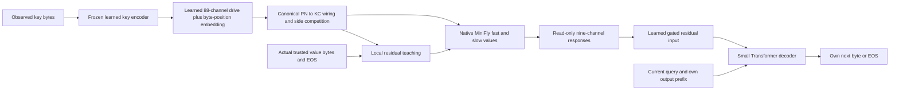

# MiniFly as external memory for a small Transformer — V1

**22 October 2026 · Design only · No implementation, training, experiment or GitHub push authorized by this delivery.**

Build a small byte Transformer that can use information written into MiniFly after the Transformer is frozen. The first question is whether MiniFly can supply persistent, causally useful episodic memory. The Transformer handles byte encoding and output generation; native MiniFly plasticity stores the new associations.

The user's request explicitly permits a Transformer for this separate host experiment. Self-attention and backpropagation are permitted in the host and its offline-trained bridge. MiniFly retains its local native update rule: no attention, Transformer, ELM, gradient-through-memory substitute or arithmetic-specific structure is added to it. Historical addition experiments and their no-Transformer contracts remain unchanged. This track does not replace the addition research objective or turn a memory result into addition success.

## 1. What the evidence does and does not support

| Existing asset | Evidence available | Consequence for this design |
|---|---|---|
| [R_center V1](../r_center_core_v1/README.md) | Qualified byte-to-memory adapter for a fixed 12-byte cue protocol and four output labels; its private address uses four recent non-space bytes | Reuse its native lineage, not its restricted parser or answer alphabet |
| [v5.1 native engine](../minifly_v5_1_dev_20261020/engine.py) and [port assay](../minifly_v5_1_dev_20261020/cycle2.py) | Matched-reference native reads and nine independent byte/EOS compartments; an isolated disjoint-address fixture acquired taught replies | A useful primitive, not evidence that realistic overlapping keys or new interfaces work |
| [v5.1-R2 report](../minifly_v5_1_r2_dev_20261020/REPORT.md) | Observed-byte aliasing repaired, but completed addition histories had zero exact taught and held answers; the run stopped at its CPU cap | Do not use the R2 arithmetic wrapper as an already qualified text-memory service |
| [V9.9A](../../BYTE_CORE_V9_9A/REPORT.md) and [V9.9B](../../BYTE_CORE_V9_9B_RANK/REPORT.md) | Limited native-value reuse on synthetic relation tasks, with explicit controls and limits | Motivation for native memory research, not inherited language-model or arbitrary-value memory capability |

V1's primary endpoint is **E1 persistent taught association used by a host**. Test keys are new to host pretraining, but their particular values are explicitly written into memory before recall. That is new-episode memory, not never-taught relation generalization. A raw exact-key table can pass this task. The project objective contract therefore prevents calling this a general persistent learning core, arithmetic E3, or an NLP result.

Research supports testing the separation between a language model and an external store: [kNN-LM](https://arxiv.org/abs/1911.00172) combines LM predictions with an explicit datastore; [Memorizing Transformers](https://arxiv.org/abs/2203.08913) uses a non-differentiable memory of past representations. Those systems do not validate MiniFly's native plasticity. Here the candidate's episode-specific information must reside in neural fast/slow state, rather than an exact or nearest-neighbor record store. [Memory-augmented one-shot learning](https://arxiv.org/abs/1605.06065) also motivates episode-level training and testing with fresh associations. These are design precedents, not claimed replications.

## 2. One small host and a pinned native backend

### Transformer host

Train from scratch; no pretrained model download is needed for this controlled test.

| Item | V1 choice |
|---|---|
| Architecture | Four causal pre-LayerNorm Transformer blocks |
| Width / heads / feed-forward width | 128 / 4 / 512; GELU |
| Vocabulary | 256 payload bytes plus BOS, WRITE, READ, KEY_END, VALUE, EOS and ABSTAIN: 263 tokens |
| Context ceiling | 256 tokens; positional embeddings are learned |
| Dropout | Zero, including attention dropout; the key pass is deterministic |
| Output head | Untied from input embeddings, so later decoder fitting cannot move memory keys |
| Key encoder | Input/position embeddings and blocks 1–2, applied to a fresh key-only sequence |
| Output decoder | The same lower stack plus blocks 3–4 and the output head |
| Approximate parameter count | 0.92 million including the bridge and training-only auxiliary heads; implementation must report the actual count |

All 256 bytes are legal payload. Typed controls occupy separate IDs; a payload newline, NUL or equals sign is not a hidden delimiter. The application supplies record boundaries and key/value fields. Recognizing arbitrary facts in free-form prose is a later integration problem, not an ability assumed by V1.

The service key ceiling is 64 payload bytes and the value ceiling is eight. The primary test uses 16-byte keys and four-byte values; the ceilings are interface limits, not evidence over every supported length. The decoder sees `[BOS, READ] + key + [KEY_END, VALUE] + its own output prefix`, never earlier write records.

### MiniFly backend

Use the published nine-compartment native engine from `minifly_v5_1_dev_20261020/engine.py`, with its source and transitive native assets pinned by hash. Use the **canonical 5,177-cell anatomy**, rather than the 65,536-cell resampling used by the recent arithmetic wrapper. Each of nine compartments has independent mutable state over that anatomy. They encode eight byte bits and a distinct EOS channel.

Primary allocation is the engine's existing `gated=False` native allocation. This choice avoids making a new external-memory interface depend on the strict q consolidation hypothesis. It does not establish that native allocation is superior: both allocation arms failed the recent addition diagnostic. Strict q remains an untested alternative for this application, not an extra V1 candidate grid.

Retain native Q/T/F/MM, time constants, clipping, signed update equations, matched zero-value reference and temperature T=2. Use the actual native side masks and active fraction, approximately 0.035355339. Keep float64 in the native engine; host arithmetic may use float32. Do not import an old engineered answer predictor or a C16 arithmetic codebook.

This is a **new host-to-native adapter around a pinned native primitive**, not unchanged Full151 behavior. Its bridge, stateless read API and overlapping addresses require qualification.

## 3. The interface: learned keys, native values, host output



### Stable query construction

For a key `k`, execute the lower two Transformer blocks on `[BOS] + k + [KEY_END]`, with a fresh attention cache. Let `h(k)` be the final hidden vector. This same function is used at write and read time. Other records, the value, write/read role, answer length and an evaluator's identity never enter this pass.

Freeze any normalization parameters in this path as well. Test deterministic same-key output across training/evaluation mode switches; freezing weights alone does not disable stochastic layers.

For byte position `j` in 0…8:

```text
p_j = tanh(W_key * LayerNorm(h(k)) + e_j)          # 88 learned channels
raw_j = B.T * p_j[pn_type_index] - theta          # pinned native wiring
x_j = deterministic positive side-wise top-k(raw_j)
```

The 88-channel dimension and native PN mapping come from the pinned anatomy. Position embeddings are generic serialization coordinates, not digit places or arithmetic roles. `W_key` and `e_j` learn from generic byte reconstruction and position supervision. No hash-to-disjoint-cue helper or semantic key features are used in the candidate.

Before any episodic native writes, estimate `theta` as the per-KC mean raw drive over at most 4,096 training-only key/position frames. Freeze it. This generic centering is a disclosed new bridge calibration, not an inherited qualification. It receives no value labels. Retain actual side-wise activity selection and stable index tie resolution. Report collisions, support overlap, occupancy, cutoff ties and sensitivity to changing key bytes; never resample test keys to hide bad addresses or demand orthogonal keys as a capability gate.

Freeze the key encoder, `W_key`, position embeddings, calibration and all address circuitry before host–memory fitting. Upper decoder layers can then learn to interpret reads without moving stored addresses. Freezing only the native weights while changing the key encoder would invalidate old associations.

### Trusted write

The application calls `write(key, observed_value, time, write_enabled)`. A value must have actually arrived from the trusted data stream. At position `j`, prepare `x_j` and read the native response **before revealing the corresponding target**. For byte `b`, teach its eight bits and EOS-off; at the terminal position, teach only EOS-on. The expected byte and expected total length cannot change `x_j`.

Use the existing residual:

```text
m = learned_native_read - matched_zero_value_read
s = a(n) * (tanh(m / 2) - target) / 2
a(n) = (1/16) * [1/16 + (15/16) * min(n/1024, 1)]
```

Here `n` is completed external write records in this fresh memory life, not internal byte events, host optimizer steps or scored queries. Start at 1/256; do not jump to full-strength teaching. Count every repeated presentation. Use dt=30/14 simulated seconds per written byte/EOS native event and the inherited BEGIN adaptation reset. No replay is enabled in V1. Check the native event/reference bridge against its scalar parent before using it.

`write_enabled=False` preserves observations, timing and passive native dynamics while disabling value writes and confirmations. Main allocation is native, although the reused engine may still allocate bookkeeping arrays; report what it actually allocates rather than subtracting unused fields from measured memory.

### Read and generate

`read(key, query_time)` returns up to nine response vectors, one for each position 0…8. It supplies **no text, retrieved record, key list, known length, membership flag or expected answer**.

Define this API prospectively: advance one private native snapshot to the query time, reset its transient adaptation as at BEGIN, and evaluate all position addresses against that snapshot without teaching or ticking between positions. Each response uses the same pinned read horizon. This differs from the old port's sequential private ticks and therefore needs an explicit adapter test; it is not assumed numerically identical to that protocol. Query calls do not advance the persistent learning clock. The environment advances that clock through declared writes and rests.

In the main experiment, `query_time` must equal the current scheduler/native-life time; future time is supplied by an explicit REST before the query. Reject backwards or undeclared future times. This prevents a future-time read followed by an earlier-time write while keeping the read itself immutable.

Reading all nine positions has a fixed cost and can use one CPU-to-host transfer. It does not consult the true value length. The resulting nine vectors are a transient cache for this query only, cleared at completion. Every one of the nine reads counts even if the host emits EOS early. Query-time forward arrays are private; native values, q, thresholds, counters and any persistent caches remain unchanged.

At host output step `j`, inject the returned signal after block 2:

```text
u_j = tanh(m_j / scale)                           # training-only fixed per-channel scales
g_j = sigmoid(w_gate * h2_j + b_gate)
h2_j_augmented = h2_j + g_j * W_memory * u_j
next_token_logits = decoder_blocks_3_4(h2_j_augmented)
```

Fit `scale` on actual native responses from the first 64 H1 training episodes, without test data or host parameter updates. These episodes count inside H1's episode and exposure ceilings. Use the median absolute response per compartment over known-written keys, with a floor of sqrt(float64 machine epsilon), then freeze it before decoder fitting. Preserve signed information and record any saturation. Do not tune normalization using held query correctness.

The host chooses all emitted bytes and EOS. Its previous outputs, not teacher prefixes, feed subsequent generation. There is no payload mask, arithmetic decoder, forced four-byte answer or forced EOS. At eight payload bytes, a further payload proposal is truncation and wrong. ABSTAIN followed by the host's own EOS is a valid response only for an absent key. Generated outputs never become memory writes automatically.

## 4. Train the interface, then freeze it before new facts

**H0: learn byte encoding and the protocol.** Train the host from scratch on generic byte sequences. Half the sampled examples reconstruct a key through its key-only bottleneck, with no alternate raw-key path to that reconstruction decoder. Sample positions 0…8 and train a small auxiliary position classifier from `p_j`, so position inputs are actually trained. This auxiliary target is the generic byte index, not an arithmetic feature. The other half are short-context WRITE/READ byte-copy examples, with the value explicitly present in that training context, to train the typed protocol and output serialization. This ordinary host training does not establish persistent external memory: write context is removed in the later experiment.

Use mean byte/EOS cross-entropy plus mean position cross-entropy on the bottleneck examples, with equal objective weight as the initial design choice. Use AdamW, initial peak learning rate 3e-4, 200-step linear warmup, weight decay 0.01 and gradient clipping 1, with minibatches of 16 examples. These are provisional optimizer settings, not empirically qualified choices. Ceiling: 1,048,576 predicted payload-byte/EOS tokens and 4,096 optimizer updates, whichever arrives first; count auxiliary position targets and all input bytes separately.

Then freeze all address-producing parameters and calibrate `theta` on training keys. The auxiliary key reconstruction path is training-only and cannot store online facts or answer scored queries.

**H1: learn to use actual native reads.** Train only decoder blocks 3–4, the untied output head, memory projection and read gate. Use fresh random key/value episodes; reset native values between episodes. Native writes use the real local rule and actual observed value bytes. Query losses train the host, but gradients stop at the returned native vectors. Do not use a differentiable surrogate memory, differentiate through native updates, or substitute a table for candidate training reads.

Use known and absent-key training queries. Gold query answers enter the offline loss only after forward generation; they do not enter addresses or candidate read vectors. Ceiling: 2,048 training episodes and 262,144 query target tokens. Each episode uses 16 random facts and four presentation passes. Stop at the first ceiling. Log all host targets, memory observations, internal reuse, native events and optimizer steps. The same write is not a free exposure merely because it occurs during host training.

For H1 decoder fitting, use the same AdamW peak learning rate, weight decay and clipping as H0, with a fresh 200-update warmup and minibatches of eight query sequences. The normalization episodes have no host updates. Record the exact optimizer/scheduler state and token accounting in the implementation lock; no hidden gradient is passed into frozen key parameters or native state.

**Freeze before evaluation.** Freeze the entire host, bridge, output head, gate and normalization. Each new test world starts with empty native learned-value state. The only persistent changes permitted in that world are native local memory changes caused by explicit writes. Hash host/bridge parameters before and after each life. Reset host KV caches and all transient activations after every write and query. The writer runs only the key encoder on the key; it does not leave a Transformer representation of the value available for recall.

No performance is promised from these budgets. A failed key codec, weak native acquisition or resource stop is a valid prototype result, not permission to expand the model, rate or data automatically.

## 5. Controlled experiment

### Data and chronology

Primary data consists of 16-byte random keys and independently sampled four-byte random values, including all 256 byte values. Associations are generated after the host is frozen. Deduplicate exact keys, not neural addresses. Use disjoint key identities across host training, development and final evaluation; no world IDs or random seeds enter model inputs.

Per world with load `M`:

1. Begin with empty native learned values and cleared host caches.
2. Present M OLD key/value facts in 16 seeded shuffled passes. Probe after passes 1, 4 and 16; these are correlated checkpoints in one life, not extra independent samples.
3. Rest one simulated hour. Probe OLD before any more teaching.
4. Present M disjoint NEW facts once, supplying their actual values. Probe OLD and NEW.
5. Rest another hour. Score OLD, NEW and eight never-written keys, with no query feedback.

The **primary endpoint** is exact OLD value plus own EOS after both rests and NEW learning, at M=16 and 16 OLD presentations per fact. One- and four-presentation results are important sample-efficiency curves, but this protocol does not test their retention through the later interference phase. The largest OLD dose is 256 records, so the gradual native schedule does not reach its ceiling; report that limitation rather than calling this a maximum-dose capacity test.

Use four fixed development worlds with M=8,16,16,32. These loads bracket the primary point without assuming capacity. The final frozen roster is 32 fresh M=16 worlds under **one frozen host checkpoint**. Inference is conditional on that trained host; 32 worlds are not 32 independently trained hosts. Reproducibility over separately trained hosts is a later replication if the first design works.

The canonical native anatomy is shared across these worlds; each world has independent empty mutable memory and newly sampled data. The number of worlds measures repeatability over episode assignments, not diversity over biological anatomies.

Proposed seed namespaces: host training 202610225001; technical fixtures 202610225101–102; development 202610225201–204; final worlds 202610225301–332. These are reservations only. Check all prior rosters for collisions before generation. Freeze the actual splits, streams and source before inspecting final outcomes.

Variable-length values of 0…8 bytes and same-key value revision belong to a separately reported technical extension after the primary interface works; they are not silently pooled with the fixed-length primary endpoint. Never infer unrestricted text storage from four-byte facts.

### Arms and causal controls

| Arm/view | What it tests |
|---|---|
| F-W: Transformer + MiniFly, correct writes | Candidate hybrid |
| F-N: identical host, observations and clocks; native writes off | Whether online native learning carries the new facts |
| F-SH: identical host; OLD values permuted among keys | Whether correct key/value binding matters; preserve lengths and value multiset |
| ZERO: read F-W's query with every memory-response vector replaced by zero | Whether the scored decoder actually uses the memory input; no extra training life |
| FOREIGN: read F-W with another world's read vectors, or a locked key permutation within the same checkpoint | Whether retrieved content matters rather than gate activation alone; never inject the evaluator's target |
| T-ONLY: same frozen host, memory disabled and no native computation | Host-only accuracy and actual execution cost |
| EXACT-TABLE: bounded exact-key store of the same observed records, supplying read vectors to the host | Positive control and recitation/cost baseline; explicitly not a MiniFly candidate |
| DELTA: same frozen addresses, ordinary normalized local delta-rule associative weights | Whether native plasticity adds anything over a simpler associative store |

F-W, F-N and F-SH share a host/bridge checkpoint. Only the designated native learning intervention differs. ZERO and FOREIGN are readonly paired lesions of F-W; they are not extra independent worlds. F-SH uses one locked value permutation through all OLD passes; NEW is correctly written. Also score whether its outputs follow the permuted assignment, separately from scoring against original truth.

The EXACT-TABLE arm stores only observed keys/values. An additional diagnostic may inject known-correct bit/EOS vectors from that store into the same host. This tests the decoder/serialization path and never supplies candidate answers. DELTA uses `W += eta*(target-W*x)*x/(epsilon+dot(x,x))`, masks byte channels at EOS, and uses the same key/position frames. Fit its read normalization and decoder adapter on training episodes under the same target budget, then freeze them. It is a separately trained reference, not a clean causal lesion of F-W. Report its actual smaller/larger costs; do not pad unused arrays and call it memory-matched.

Use a locked nonzero cyclic permutation of OLD record indices for F-SH, with no fixed index assignments. Report any coincidentally identical values. For FOREIGN in final evaluation, use the locked cyclic permutation of keys within F-W's own current checkpoint, rather than an unspecified other world's mutable state. DELTA starts with eta=1 and epsilon=1e-12; this is a transparent normalized error-correction reference, not a hidden hyperparameter search.

For all backends, raw buffers and lookup tables needed to drive the experiment stay in the evaluator. The candidate process has no access to them at query time. Per-record temporary write buffers are cleared after use. No raw-record index, key directory, nearest-neighbor datastore or backup answer cache is permitted in the candidate.

## 6. Endpoints, interpretation and decision

Record whole-value exact accuracy with own EOS as primary. Also record per-byte/bit agreement, value length, early/late OLD retention, NEW acquisition, false answers on absent keys, explicit abstention, address collisions/overlap, native/reference margin distributions, applied fast/slow write mass, and dependence on the memory gate. Teacher-prefix measures remain diagnostic and separate from own-prefix output.

Reduce exact accuracy within each world before paired world comparisons. Predeclare the three attribution contrasts F-W minus F-N, ZERO and F-SH at the final OLD endpoint. Report paired world-bootstrap mean differences and simultaneous nominal lower bounds using Bonferroni alpha=0.05/3; retain the unadjusted effect sizes and all world rows. Bootstrap coverage is an approximation at 32 worlds, not an exact guarantee. FOREIGN and other endpoints are diagnostic rather than extra confirmatory claims.

Technical memory-source feasibility requires source/readonly/cache isolation, a correct oracle-fed byte/EOS codec on its finite exhaustive fixtures, and positive simultaneous lower bounds for all three attribution contrasts. A positive exact effect proves useful episodic information reached the host through native state under this protocol. It does not alone establish good storage efficiency.

Do not pick an arbitrary accuracy percentage to declare deployment success. Show accuracy against **all observed write presentations, training tokens, CPU, wall time, latency and persistent bytes**. EXACT-TABLE can be perfect after one observation; a slower, larger, less accurate MiniFly store can pass the causal-memory test while being dominated as an engineering solution. A native advantage requires a measured cost/quality tradeoff or a separately designed capability the simpler references lack. Report TECHNICAL_MEMORY_EFFECT and NO_PRACTICAL_ADVANTAGE separately if that is what happens.

| Outcome | Supported next action |
|---|---|
| Correct stored vectors cannot be rendered by the host | Fix the host/codec; no conclusion about MiniFly storage |
| Same key produces changing addresses | Fix the bridge freeze/cache protocol before capacity claims |
| Direct native bit reads fail despite stable addresses | Diagnose native write gain, overlap and interference with the real bridge |
| Native bit reads work but host answers fail | Investigate normalization, fusion and sequential decoding |
| Candidate answers survive no-write/zero/foreign lesions | Investigate leakage or host shortcuts; do not credit native memory |
| Causal memory works but table/DELTA dominates | Report a working glue experiment without a deployment advantage |
| Useful causal effect and measured competitive tradeoff | Design a fresh replication, then broader text/semantic memory tasks |

Arithmetic generalization stays a separate endpoint. A Transformer solving an arithmetic question using recalled facts would need its own attribution experiment; it would not retroactively establish that MiniFly learned arithmetic rules.

## 7. Cost, bounded workflow and delivery

Canonical native state is finite, not a text database. Nine compartments with the current engine's full forward/q/ring arrays allocate about **5.42 MiB of mutable arrays at N=5,177**, before fixed wiring, Python objects, clones and experiment storage. The roughly 0.92M host parameters require about 3.7 MB at float32, before optimizer state and activations. These are array estimates, not measured RSS. Report both active fractions and full projection/sort/sweep work. Each query performs nine native reads even when output ends early.

One world has `16*M + M = 17*M` observed write records per learning backend. Across the four planned development worlds and 32 final worlds, sum(M)=584: **9,928 records per backend**, or **29,784 full native record applications** for F-W/F-N/F-SH. The OLD and NEW values each have four bytes plus EOS, giving five native teaching/passive events per record in this primary task. DELTA/table record processing, all host training, technical extensions, queries and losses count separately. These are prospective counts, not completed work.

Before a large run, profile a **whole episode including every control, generation and audit copy**, not a training-only prefix. The R2 experience shows why the latter underestimates cost. Log host encoding, native writes, native reads, transfers, host decoding, optimizer work, checks and packaging separately.

Prospective implementation order:

1. Static source/interface review, then a bounded E0 fixture suite: typed bytes, EOS, target-free addresses, native/reference parity, no-write invariants, snapshot isolation, cache clearing and checkpoint recovery.
2. H0/H1 training within the declared sample ceilings. Freeze a single host/bridge checkpoint; qualify direct native reads and the oracle-fed host codec. A weak component remains visible in a bounded complete-world trial instead of being hidden behind another isolated fixture.
3. Four development worlds with actual host output and every control. Lock all executable details. If revised, use a new version and new worlds; do not reuse final outcomes for tuning.
4. Only after explicit future execution authorization and a qualified bounded prototype: the frozen 32-world evaluation, independent reduction, report and compact package. No run is launched by this document.

Use one worker and one numerical thread initially. Prospective total execution ceilings are two hours process CPU and two hours wall time, including host training, native work and evaluation; RSS ceiling 2 GiB with at least 2 GiB measured system headroom. Profile first and return RESOURCE_LIMIT if the declared plan cannot fit. The two-hour number is an operational ceiling, not a model-quality threshold or a claim of likely runtime. Any accelerator use or budget amendment requires a prospective resource record. Never reset elapsed counters or quietly shrink the task to finish.

Preserve actual failed work, all exposures, model/bridge/native asset hashes, paired streams, emitted bytes/EOS, parameter-isolation certificates and an independent artifact reduction. Final audits must distinguish integrity acceptance from memory efficacy and practical advantage. Keep large states locally with hashes if using a compact publication bundle. Caffeinate follows an active future controller only while authorized computation is running. No automatic retries, larger model, added dose, new candidate family, publication or adoption follows a failure.

## 8. Status of this delivery

This delivery is the design Markdown, a machine-readable specification, a static document review and source/evidence hashes. It contains **zero new model implementations, training records, diagnostic model runs or scientific jobs**. The separate external-memory planning pointer records this requested Transformer exception; the arithmetic pointer and frozen experiments are unchanged.

The recommendation is to test **one small learned byte host + one native memory backend**, with strong source-of-information controls. A working memory connection is a worthwhile engineering result. We will measure whether it is useful and economical rather than assuming prior taught-cue results already answer that question.
