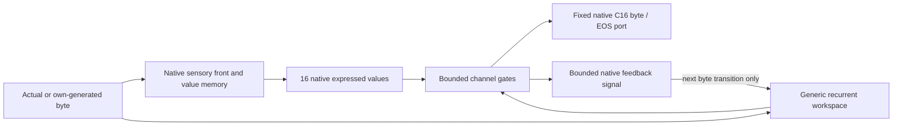

# MiniFly V169 — short-path credit through native memory feedback

**Date:** 26 October 2026. **Status: design only.** No implementation, model execution, scientific result, adoption or GitHub publication follows from this document. The prospective budget below is a ceiling for a separately requested exercise, not a launch authorization.

**Goal:** improve retained, complete own-byte/EOS answers to never-taught addition problems per **all** training presentations, revealed targets and actual compute. Keep gradual warmup, local candidate updates, arbitrary byte payloads, and the Full151 native memory lineage. No attention, Transformers, ELM, arithmetic parser/features/rules, intermediate arithmetic targets, or external answer decoder.

## 1. The question and the evidence behind it

Test one new operation: **native expressed values alter the next ordinary recurrent state, whose learned gates alter the expression of native values at the next output.** Test whether a bounded three-step feedback circuit can train this operation better than immediate credit alone.

V157's fixed-dose scheduling comparison established no unseen-addition gain and exposed some OLD retention loss; its secondary record lacked 992 immediate margins. V167 shows useful locally trained features under an external BP transfer probe, not an integrated native arithmetic learner. V166 demonstrates memory-guided composition under structured inputs and BPTT; V168's three-step gradient window performs far better than immediate credit on that fixture. None establishes that three steps suffice for byte-level addition.

There is also an eligibility correction: V166's learned query scores stored keys and mixes their values. The standing [no-attention requirement](../PROJECT_DOCUMENTS/NO_ATTENTION_KERNEL_REQUIREMENT_20261013.md) excludes that operation, including equivalent fast-weight retrieval. V169 does **not** reuse it. It reuses the permitted idea of a memory-to-state feedback connection, through fixed neuron connections and channel-wise gates.

This is an explicit completion and narrowing of [V157's C protocol](../minifly_v157_design_20261026/ARCHITECTURE_PROTOCOL.md). V169 first tests **read expression and feedback**; it does not additionally learn native cue construction or writing policy. This smaller contrast has an exact conditional numerical reference despite native hard KC selection. A negative result leaves cue modulation open; it does not eliminate recurrence or native feedback as families.

## 2. Actual parent and the changes

Pin native sources to commit `ec38e8be63e0a448d387e4698fd619c7368ddf12`:

- `minifly_v154_dev_20261025/native154.py`: `Native('N_2B','P_SLOW')`.
- `minifly_v152_dev_20261025/models152.py`: categorical C16 port, signed teacher and gradual native warmup.
- `minifly_cls_dev_20261017/fastmem.py`, `OUTPUT_CODEBOOK.json`, and their complete transitively imported source/asset closure.

Preserve the canonical 16 native compartments, PN/KC connectivity, hard KC competition, fast/slow updates, fresh adaptation, P_SLOW sensory front, existing clock order, and `homeo=False`. Preserve the 257-by-16 arbitrary C16 output code `C`; all 256 payload bytes and distinct EOS=256 remain legal. The categorical bias `q` stays zero. No classifier is fitted outside the operative candidate.

Add a generic recurrent workspace and multiplicative native expression gates. Native memory remains necessary for nonuniform output, but this structural fact alone does not prove learned knowledge is used: a constant carrier could support a controller shortcut. Section 9 tests that possibility.

**Native writer isolation is deliberate.** Its signed error is calculated from the original ungated native prediction, exactly as in N_2B. The new controller learns from its own gated prediction. Both see the same actually revealed target, after prediction. This prevents a change of writer from explaining a controller contrast. It also means V169 does not test whether jointly redesigning the writer would work better.

The output path changes from native C16 expression to **gated native C16 expression**. Call it an augmented Full151-lineage reader, not unchanged Full151 or an already validated upgrade. No V167 weights, V166 key/value store, or engineered addition package is transplanted.

Teacher feedback reaches the unchanged native writer and the separate local controller teaching circuit only after prediction. The diagram's feedback edge carries expressed values, not a query into a key/value table.

## 3. Exact forward model

### 3.1 Dimensions, connectivity and birth

Use H=64 workspace neurons. For each neuron j, select its own recurrent input and three distinct other neurons, independently of task data. Each of 16 gate neurons receives eight distinct workspace neurons. Native-to-workspace connections are fixed in topology: all 16 native channels can reach each workspace neuron. These are ordinary synapses, not candidate memory entries.

Trainable arrays are byte embedding `U[64,256]`, recurrent edge values `W[64,4]`, native feedback weights `R[64,16]`, bias `b[64]`, gate edge values `G[16,8]`, and gate bias `c[16]`: **17,872 parameters**. Channel numbers have no digit, operand, carry, position or arithmetic-operation meaning.

Use independent PCG64 streams from the first 16 SHA256 bytes of `V169|world|name`. Topology stream names are `recurrent_edges`, `gate_edges`; birth weights use `U`, `W`, `R`, `G`. Uniform initial ranges: U ±1/16, W ±1/64, R ±1/128, G ±1/32; b=c=0. OFF64 and credit-length controls share the corresponding ON birth arrays exactly. Fixed feedback signs use separate `F_W`, `F_R`, `F_G` streams; no target information enters birth.

### 3.2 One transition per arriving payload byte

Let v_t be the actual 16-component native value read for the current context. Define

\[
\begin{aligned}
\bar v_t &= v_t-\operatorname{mean}(v_t),\\
u_t &= \tanh(\bar v_t/4),\\
z_t &= \tanh(U e_{x_t}+W h_{t-1}+R r_{t-1}+b),\\
h_t &= \tfrac34 h_{t-1}+\tfrac14 z_t,\\
a_t &= G h_t+c,\qquad g_t=1+\tfrac12\tanh(a_t),\\
r_t &= g_t\odot u_t,\\
o_t &= C\,[g_t\odot v_t-\operatorname{mean}(g_t\odot v_t)]/4,\\
p_t &= \operatorname{softmax}(o_t).
\end{aligned}
\]

Sparse products W and G use only declared edges. `e_x` is a one-hot raw byte, implemented by a column lookup; the embedding is learned. Initialize h and r to zero at each generic record boundary. Store weights and native memory persist across records; workspace state and credit buffers do not.

The identity gate gives exactly the parent's output distribution. The bounded gates lie between 0.5 and 1.5, providing a small initial change and limiting instantaneous amplification. This deliberately restricted reader might be insufficient; the numerical reference tests that uncertainty. There is **no additive h-to-logits path**, learned vocabulary bias, key/query projection, memory-position scoring or weighted pooling of stored episodes.

The factor 4 is the existing sqrt(16) C16 scale. The tanh on native feedback bounds a signal fed to recurrent neurons; it does not replace the raw values in the output. Vocabulary softmax classifies bytes only.

### 3.3 Clock, teaching and generation order

1. Begin a record using the parent's native begin control, resetting its sensory front/fresh adaptation as originally specified; set h=r=0 and clear credit buffers.
2. For every provided prompt byte x, execute the parent's nonteaching native byte event. Advance h once using x and **the preceding** r, read native v without mutation, and form the current gates and r. Extra reads may not advance native time, adaptation, counters or stores.
3. Execute the parent's end-of-prompt control tick. Refresh v, gates, r and p with **the same h**; do not insert a special recurrent query/wait step. This refreshed read replaces that transition's read latch. Only generic record/request-output boundaries are available, never an arithmetic parser or supplied answer length.
4. At a supervised answer site, commit p and its own argmax before revealing y. Compute the controller teaching signals below. Independently calculate the parent's ungated distribution p0 and its unchanged N_2B signed coefficient. Execute the original native teaching tick/code/write and, for a payload target, feed the actually arriving target byte. Advance h once for that payload using the previously latched r; obtain the next v/read latch. EOS teaches/stops but is not inserted as a payload byte.
5. Controller weights are fixed throughout a record. Apply accumulated **local** controller updates once, after its externally supplied EOS. Clear working state and credit. Do not replay the record.

At recall, clone the model, execute the same prompt and boundary sequence, choose its own argmax, and feed only its generated payload bytes through nonteaching native events. Stop solely on its chosen EOS, or report CAP after four decisions. A four-decision cap is not EOS. No true answer, target prefix, numeric length, dataset ID or expected error reaches generation. Persistent model state must remain unchanged by evaluation.

Provided-prompt capacity is 64 payload bytes; longer prompts report INPUT_CAP. Observed reply length in this experiment is at most two payload bytes, while free generation has the four-decision cap above. The task uses shorter prompts, but candidate code accepts arbitrary byte values. No free internal calculation steps, externally selected iteration count or special arithmetic token interpretation is introduced.

## 4. Local three-step credit: a feedback circuit, not a dense gradient

### 4.1 Direct teaching at the gate

For a revealed y, put e=p-onehot(y) and

\[
d_v=\operatorname{center}(C^\top e/4),\qquad
\delta^a_t=\tfrac12\operatorname{sech}^2(a_t)\odot v_t\odot d_v.
\]

Each gate synapse receives its postsynaptic signed teaching signal and its own stored presynaptic activation: accumulate `delta_G += delta_a outer h`, on existing edges, and `delta_c += delta_a`. The fixed C16 feedback port carries expected-output feedback permitted by the user; it contains no arithmetic relations or intermediate answers.

Define separate fixed feedback connections:

- F_G: gate error to workspace, on the reverse **topology** of G;
- F_R: workspace teaching signal to the 16 feedback-channel gates, on the reverse topology of R;
- F_W: workspace teaching signal to preceding workspace neurons, on the reverse topology of W.

Draw signs independently of forward weights, ±1/sqrt(d), where d is the recipient's number of incoming feedback connections; use zero for a recipient with no edge. Do not tie, transpose, align by optimization, or fit these feedback weights to a reference. They are permanent feedback synapses.

### 4.2 At most two delayed feedback rounds

For the error delivered at current site t, initialize the workspace modulator `m_t=F_G delta_a_t`. A transition has local derivative `d_j=(1-z_j^2)/4`. At j=t, t−1, t−2, while a transition exists in this record:

1. Set `xi_j=d_j * m_j` elementwise.
2. Each incoming U/W/R/b synapse accumulates `xi_j` times **its own** presynaptic trace from transition j. For U, only the column of the actually arriving byte is touched. No U contribution exists for a control-only tick, which is not a transition here.
3. If another delayed round is permitted, the feedback circuit forms

\[
\begin{aligned}
\gamma_{j-1}&=\tfrac12\operatorname{sech}^2(a_{j-1})\odot u_{j-1},\\
\epsilon^a_{j-1}&=\gamma_{j-1}\odot(F_R\xi_j),\\
m_{j-1}&=\tfrac34 m_j+F_W\xi_j+F_G\epsilon^a_{j-1}.
\end{aligned}
\]

   The gate synapses at j−1 also accumulate `epsilon_a outer h_(j-1)` and its gate-bias contribution.

Add contributions from all revealed output sites, weighted by their own warmup value, without replaying sensory events. The current gate update is direct; earlier gate updates receive the carried memory-conditioned signal. The u term is the actual native expressed content at that earlier context, not an episode-independent scalar reward.

Only three recent age-tagged local compartments are retained per node/synapse endpoint: arriving byte index, presynaptic h/r, local z/h/a and read-latch u. Each synapse updates from its local trace and its postsynaptic modulator. Error communication traverses the specified feedback edges for at most two rounds. There is no global Jacobian, RTRL tensor, stochastic Kronecker merge, backward autograd call, history-sized eligibility array or access to another record's targets in a candidate.

This is an **explicit circuit-local computational hypothesis**, not an assertion that flies implement it. Signed teaching, age tags and synchronized feedback phases are declared implementation assumptions. Feedback travels across neurons; a within-neuron decay trace alone is not being presented as the missing operation. Three steps is a fixed diagnostic choice motivated by V168, not a proved universal arithmetic credit horizon.

### 4.3 Update size and warmup

Retain native warmup `wN(n)=1/16+(15/16)min(n/1024,1)` and its exact base-writer coefficients. For every new controller pathway use the slower shared schedule

`wH(n)=1/16+(15/16)min(n/2048,1)`.

n counts **all arriving reply bytes and EOS**, including inhibited-prior histories. Weight every target's direct and delayed contributions by wH at that target; apply `theta -= 2^-10 * clip(accumulated_local_update,-1,1)` per synapse at record end. No Adam, global norm clipping, hidden repeated passes or uncounted optimizer steps.

Elementwise weight bounds are U ±1, W ±1/8, R ±1/32, G ±1/8, b/c ±1/4; apply only to touched weights. These are engineering stability limits, not biological constants or success thresholds. With frozen native u, the recurrent and memory-gate bounds give an infinity-norm transition bound at most 15/16 for H=64, making amplification inspectable. They may also limit useful computation; changing them after outcomes needs a new design.

Log update magnitudes, saturation/clipping, feedback norms and exact warmup counters by pathway. A saturated or numerically ineffective controller is an observed result, not permission to increase its gain automatically. Later blurry/scalar-only feedback is outside this first test: warmup uses real expected outputs throughout, with no claim of learning from 0/1 alone.

## 5. The exact short-path instrument

For controller parameters, teacher-forced native v depends on the unchanged native writer and observed bytes, **not on controller parameters**. No controller output changes the base writer. Thus an exact conditional controller derivative can be defined without inventing derivatives through hard KC selection or native learning.

On the same forward model, include the direct gated output derivative and the carried state path

\[
J_t=\tfrac34 I+D_t[W+R\,\operatorname{diag}(\gamma_{t-1})G],\qquad
D_t=\operatorname{diag}((1-z_t^2)/4).
\]

The memory-mediated part has rank at most 16; **the whole recurrent sensitivity need not be low rank**. This deduction follows from the 16-channel interface, not V166's eight stored pairs. It asserts neither cheap native reads nor biological locality.

Implement an independent deterministic recent-influence reference

\[
E_t^{[3]}=B_t+J_tB_{t-1}+J_tJ_{t-1}B_{t-2}.
\]

Keep the three terms separately, with correct direct influences of U/W/R/G/b/c, native read refreshes and direct output dependencies. Do not approximate a moving window by repeatedly retaining an aggregate which still contains older terms. Parameters stay fixed within the evaluated record.

In numerical fixtures only, substituting actual forward transposes for F_W/F_R/F_G must reproduce the same-boundary exact three-transition derivative, including earlier G effects through r. Compare to independent reverse differentiation and selected central finite differences in float64. Require maximum absolute error ≤1e−7 and relative error ≤1e−6 for non-negligible blocks. At exact zero, use absolute error. Report zero/one/two-transition paths separately and test the end-of-prompt read refresh.

Two calibration instruments subsequently train the identical controller with either exact three-transition or exact full-record conditional gradients, under the same birth, update size, clipping, warmup and native observations. They optimize teacher-forced loss but are evaluated on complete own answers. They are **nonlocal instruments**, never candidate arms, never sources of candidate weights, labels or feedback matrices. Count all their presentations and compute. Their failure does not prove an architecture impossibility; their success does not satisfy the local-rule requirement.

No new V166/V168 training is part of V169. Their historical results motivate a lag, not an eligible forward architecture or a budget exemption.

## 6. Fixed comparisons

| Role | Workspace | Native→state | Credit | Purpose |
|---|---:|---|---|---|
| NATIVE | none | none | unchanged native writer | Actual parent at equal data dose |
| ON3 | 64 | R r active | local current + two delayed rounds | Main candidate |
| ON1 | 64 | same as ON3 | local current round only | Credit-length intervention on the same forward graph |
| MIS3 | 64 | same as ON3 | same three local rounds, delayed presynaptic age tags swapped | Delayed alignment versus merely doing more updates |
| OFF3 | 64 | feedback term identically zero | same local three-round rule, excluding the absent R path | Structural feedback control |
| CAP-OFF3 | 69 | feedback term absent | local three-round rule | Slightly larger active-capacity control |

OFF3 still gates its output using native values; it only lacks **memory-to-state** feedback. It does not remove native memory from the answer. It has 16,848 active controller parameters; unused R entries do not count. CAP-OFF3 uses 18,153 active parameters, 1.57% more than ON3, with the same recurrent fan-in four and gate fan-in eight. Its state/embedding work is larger. This is approximate capacity matching, not equal compute or an exact causal lesion. There is no claim that parameter number alone matches capability.

Run W and SH_OLD histories for each role. During OLD, SH_OLD receives identical sensory/target arrivals, times and warmup advances but inhibits **both** native value writes and controller parameter updates; local traces are discarded. During NEW both histories write normally. This controls prior teaching of relevant information, rather than merely later interference. It does not say that all pretraining is useful.

All roles have an unchanged base native teacher, so their teacher-forced native trajectories are mathematically identical within a world/prior. A single physical native trajectory may feed these simultaneous independent controllers, with byte-identical read receipts. This saves work without changing information. Mutable controllers must never alias. Count every logical learner presentation and separately report physical native events/shared reads. Own-generation branches remain distinct because their generated continuations can differ.

MIS3 shares ON3's birth, signals, feedback routing and number of local update contributions. Whenever both preceding transitions exist, write the lag-1 U/W/R contribution using the same synapse's stored lag-2 presynaptic trace, and vice versa; do the analogous swap of presynaptic h for the two delayed G contributions. Keep the postsynaptic modulator/derivative at its true age, current/direct updates unchanged, and bias updates unchanged. When two earlier transitions do not both exist, use ON3's updates. This deliberately mismatches delayed teaching and prior input without adding labels or updates. It matches contribution counts, not update norms after clipping; report that residual difference. It is a timing control, not an alternative candidate to select later.

## 7. Data and prospective dose

**Main worlds:** 202610269701 and 202610269702. **Calibration/reference worlds:** 202610269711 and 202610269712. **Technical stream:** 202610269790. Reserve and audit IDs before first model exposure; do not change seeds because a birth learns poorly. These are proposed fresh IDs, pending mechanical freshness verification.

Use the external V154 `dataset(world)` unchanged: unordered operand orbits for integers 0…19, 210 orbits, one sampled orientation per orbit. OLD=64, potential NEW=64, validation=32, assessment=50. The candidate receives raw ASCII prompt bytes and arriving answer bytes; only the external generator knows arithmetic semantics.

Select 16 NEW orbits by ascending `(SHA256('V169|world|NEW|id'),id)`. The other 48 NEW and 32 validation orbits are **excluded from training and scoring**. Withhold the complete commutative orbit for every assessment problem; its reversed presentation is not secretly taught. Do not teach counting lists, arithmetic identities, solution traces or extra language tasks.

Train OLD for **16 passes** using the parent's eight recorded permutations twice, then NEW for **16 interleaved passes** in selected-ID order. There are 1,024 OLD and 256 NEW record presentations per logical history, **1,280 total**, with 80 distinct taught orbits. This is a prospectively doubled dose relative to V157, shared by every role, not an extension of a frozen run. It supplies a longer gradual controller warmup and records the eight-pass points; it is not claimed sufficient or optimal. No repetitions are added if the fixed dose fails.

At OLD passes 8 and 16, evaluate OLD64+NEW16. At cumulative NEW presentations 32,64,128,256, evaluate NEW16. At 256 additionally evaluate OLD64; reuse the existing NEW16 results. Then make a passive 128-native-step copy with no new bytes or teaching, clear transient workspace state, and evaluate OLD64+NEW16. There are **368 own/teacher-forced paired records per logical history**. W/N history terminology from older experiments must not turn readouts into extra independent lives.

Do not separately generate a complete answer after every training record. Instead persist every declared **actual teacher-forced pre-update** target/argmax/margin/probability and local signal, and complete own answers at the stated panels. A teacher-forced prefix margin is never labeled complete acquisition.

All main branch taught endpoints, integrity audits and selection-free reports are locked before any assessment answer is joined. Then score all 50 held prompts at final and post-idle endpoints for every main role/prior, **including when acquisition is poor**. These are 2,400 correlated base own-only decisions over 100 held orbits, not 2,400 independent examples. The two reference worlds' held assessments stay unopened.

## 8. Endpoints, claim levels and decision rules

**Primary objective endpoint:** complete exact own-byte/EOS held accuracy after NEW and after idle, at equal total training dose. Commit output bytes/EOS/CAP before external scoring. Require exact equality of the entire answer and its own EOS; correct first bytes, teacher-forced accuracy and likelihood do not pass.

Report these prespecified contrasts per world and dose:

- ON3−NATIVE: net end-to-end effect of the augmented reader at equal samples.
- ON3−ON1: effect of the delayed local credit on the same forward architecture.
- ON3−MIS3: correct pairing of delayed credit and preceding presynaptic activity, beyond an equal number of delayed updates.
- ON3−OFF3 and ON3−CAP-OFF3: native feedback versus its lesion and active-capacity alternative.
- W−SH_OLD within each role: whether earlier teaching actually helps never-taught answers, conditional on later NEW teaching.
- OLD complete recall and retention of the subset actually correct at OLD pass 16; report zero denominators. Also report the same initially correct set under both matched branches rather than selecting different survivors.

Expose a fixed dose curve rather than inventing an after-the-fact success threshold. For held endpoints use paired per-orbit contrasts; conservatively treat the two worlds as two replication units. Display raw counts, paired discordances and per-world uncertainty. Do not turn hundreds of readouts from one history into a high-confidence population claim.

An **E3 development signal** requires, in both main worlds at both endpoints: strictly positive ON3−NATIVE and ON3 W−SH_OLD counts, ON3 above every declared shortcut countermodel, and positive ON3−ON1, ON3−MIS3 plus feedback contrasts. These strict sign checks are the smallest observable directional result at this resolution; they are not a significance or adoption threshold. If only some contrasts hold, name exactly the supported contrast. Formal confirmation needs a separately designed fresh-world sample size based on the observed paired effect, not automatic adoption.

An efficiency claim additionally requires improvement on the measured sample/compute frontier, including input/read overhead and warmup. Equal samples with more CPU does not establish compute efficiency. Report every arm's complete-own accuracy versus cumulative records, revealed reply/EOS targets and actual total CPU. Report paired OLD losses alongside held gains; if ON3 loses more of the shared initially correct OLD set than NATIVE in either world, retained superiority is not established. Taught losses cannot be erased by announcing a new generalization objective.

**Actual evidence levels:** input/signal qualification E0; taught acquisition/retention E1 (retention remains E1); no E2 presentation-change claim is planned; never-reinforced addition with causal prior controls is E3 only if the controls support it. No broader arithmetic or language claim follows.

## 9. Countermodels and causal memory use

Fit countermodels exclusively to the exact observed training stream, keeping repeated exposures and inhibited-prior observations visible: raw-key table, canonical-orbit lookup (evaluator only), favorite answer, per-output-position byte frequencies, prompt length, suffix backoff lengths 0…4, and a character-bag linear predictor trained on the same observations. The last is an external low-capacity shortcut audit, never a candidate; log its target reuses and compute. No hand-built arithmetic predictor or true test labels enter fitting.

For the character-bag audit use ridge least squares on byte-count vectors plus bias to observed C16 answer-site codes, with answer-site index as a generic generated-prefix feature. Lambda=1, fit once per data history; first output is evaluated without a true answer prefix, and subsequent outputs consume only its own generated bytes. Do not encode numeric values, operand roles, digit columns or parse trees. Train on all actually taught prefixes, but distinguish this training exposure from own autoregressive scoring. With a genuine relation extracted by this learned generic comparator, classify it as a stronger learner baseline rather than dismissing it as an invalid shortcut.

On frozen ON3 taught panels, perform three read-only interventions:

1. **Feedback cut:** replace R r by zero while retaining native output values, gates, weights and all other events.
2. **Constant native carrier:** replace v in both feedback and output with a single fixed vector. Its direction is born from `carrier` RNG with zero mean/unit norm; its scale is the median norm of W's actually recorded OLD native reads, locked before NEW. No current-prompt norm or held outcome enters it. This tests whether workspace/gates exploit essentially constant memory as an answer carrier.
3. **Native-zero:** set v=0. A flat output distribution is an algebraic expected result and cannot by itself establish knowledge use.

Measure matched correct→wrong and wrong→correct changes; do not count intervention scores as new training histories. If a useful ON3 gain survives the constant carrier, a native-content-use claim remains unsupported even if zeroing memory destroys output. If feedback cutting preserves the gain, the benefit cannot be assigned to the memory-to-state edge.

Also predeclare feedback-cut and constant-carrier reads on **all ON3 main held endpoints**, for both priors, before any held outcome is opened: 4 histories ×2 endpoints ×50 prompts ×2 interventions =800 extra own-only decisions. Commit their bytes/EOS alongside unmodified held decisions, then score them in the same external join. For an E3 claim specifically attributed to **native-content feedback**, ON3 W must beat both same-state interventions in each world and at both endpoints. Otherwise report any generalization benefit without attributing it to that mechanism. The zero intervention is not repeated on held inputs because its structural degeneracy is already known. No intervention is selected or tuned from held outcomes.

## 10. Three-cycle exercise if separately requested

**Cycle 1 — implement and audit the literal circuit.** Audit the complete native source/asset closure before loading it; restore missing source or small fixed assets from the pinned commit only, never historical raw data. Traverse a whole technical record through native event clocks, controller traces, target logging, checkpoint, reload, own/TF scoring, reducer and package. Use at most 32 technical observed records with arbitrary bytes and one/two-byte targets. Check all 257 output classes, prefix causality, no mutation, mutable independence, native base-writer equivalence, exact-feedback gradient identities, age-0-only identity, and gating/clamping algebra. Technical fixtures may test full lag-2 paths using recorded synthetic nonzero v; they are not science or proof of arithmetic capacity. Preserve original failures and sources.

**Cycle 2 — bounded reference qualification on calibration worlds.** Train NATIVE, exact-three and exact-full-record instruments on each reference world at the fixed 1,280-record dose. No candidate parameter or hyperparameter is selected from their outcomes. Declare the same architecture **operatively qualified at this dose** only if both exact-full and exact-three produce more complete final taught NEW answers than NATIVE in each calibration world, with no greater loss of the shared initially correct OLD set. This is a developmental feasibility gate, not proof of E3 or of optimality. If full succeeds and three fails, report SHORT_HORIZON_NOT_QUALIFIED; if neither succeeds, report FORWARD_OR_OPTIMIZATION_UNRESOLVED. Stop the planned main run without an automatic gain/rate/depth/budget search.

**Cycle 3 — local candidates on the two main worlds.** Only after integrity, resource admission and the reference gate, run the six fixed roles × W/SH_OLD. The exact reference does not initialize or train them. Complete taught audits, lock endpoints, then commit and score held answers. Report the complete objective even on a negative outcome. No new text task, replay method, protection bank, learned-key mechanism or scalar-reward stage is appended.

Before executing any whole stage, a charged technical event benchmark must show the remaining stage fits conservative remaining CPU/wall/RSS/read allowances. Failure of resource admission is not failure of a learning rule. Preserve whole-record or exactly audited partial checkpoints; no automatic retries, replay, source repairs during active science, reset of budgets, or new seed substitution. A documentation-only design check does not count as any of these cycles.

## 11. Exposure and resource budget

All repeated presentations, supervised warmup, reference fits, inhibited histories and countermodel fitting count. Report three distinct quantities: unique external records, logical learner record applications, and physical shared native execution. Do not label BP reference training as zero observations.

| Planned component | Maximum logical record applications |
|---|---:|
| Main: 2 worlds × 6 roles × 2 prior histories × 1,280 | 30,720 |
| Calibration: 2 worlds × (NATIVE + exact-three + exact-full) × 1,280 | 7,680 |
| Technical observed-record reserve | 32 |
| **Total** | **38,432** |

At most **115,296 arriving reply/EOS targets**, counting every logical arm, plus separately charged evaluator target reuses. Main/calibration worlds each contain 80 distinct taught orbits; their arithmetic relation is the same task, not four independent task families. A fully reused shared-native implementation has six physical data histories ×1,280=7,680 native record applications before technical events; logical exposure remains 38,432 at maximum. Unshared equivalent execution is legal only if it fits the same resource cap and is counted.

Paired taught panels: 30 main/calibration logical histories ×368=11,040; technical reserve64 gives **11,104 paired own/TF records**. Base held: **2,400 own-only queries**; predeclared ON3 held interventions add **800**. Three taught interventions at OLD-pass16, final-NEW and post-idle consume **2,880 additional own-only queries**: 4 ON3 histories ×3 interventions ×3 endpoints ×80 records. These are fixed reads, not extra training histories. Lock exact IDs/endpoints before execution. Their expected answers are joined only after decisions are committed.

Reserve **512 synthetic finite-difference loss evaluations** with at most three targets each and charge every target reuse. There are eleven countermodels (raw, canonical, favorite, position, length, suffix0…4, character-bag); fitting may reuse at most **115,296 target sites per model**, or 1,268,256 total fitting target reuses. Report these separately from arriving external labels and from ordinary scoring. All fitting/evaluator compute counts against the common CPU ceiling; no target reuse is called a zero-cost observation. Countermodels do not teach the candidate.

Prospective total ceilings: **4 CPU-hours** including children/reference/search/audit/package, **6 wall-hours**, one worker/one numerical thread, **1 GiB peak RSS**, **1 GiB generated output**, **400,000 native vector reads** (including evaluator/technical/interventions), **280,000 categorical distributions**, and the explicit record/query caps above. These are bounded engineering allowances, not claimed performance. Preflight may reject the plan; it may not silently expand them. Every duplicate numerical target use and any exact fixture computation remains in the ledger.

New workspace processing visits roughly 64 embedding entries, 256 recurrent edges, 1,024 feedback edges and 128 gate edges per payload byte; delayed credit traverses its feedback/forward local edges at most three times per revealed target. State is bounded by the fixed parameters, native stores, a three-transition trace buffer and one-record accumulators, not total history length. Log actual operations and touched arrays; sparse activity is not a sparse-runtime claim.

**Inherited cost remains substantial:** native projection/top-k sorts, clone-based native values, per-query model copies and whole-state digests are still present. Measure actual native vector reads, 16 compartment reads per vector, clones/bytes copied, sorts, model hashing, CPU and peak memory separately. The reader extension is not a solution to native scaling costs. A slower candidate that improves accuracy has not automatically improved compute efficiency.

Charge shared native execution once in the experiment's actual total. For per-arm comparisons, publish common native cost and arm-specific cost separately, and attribute the **full** common cost to each standalone-arm estimate; do not divide it by the number of simultaneous controllers and announce a speedup. Label such estimates as estimates. If direct standalone measurement is unavailable within the technical allowance, leave compute superiority unestablished rather than rerunning scientific histories to benchmark it.

## 12. Artifacts and allowed conclusions

Before any future run, create source/asset lock, data/split/order receipts, initialization/feedback masks, event-order manifest, qualification results and prospective limits. Preserve executed sources before revisions. Freeze a literal array schema and a whole-event round-trip fixture before admitting science.

For each actual supervised site retain pre-update native v and p0, gated p, target/own argmax, target/rival margins, clipping/saturation, warmup, h/z/a/u, trace ages, local modulator norms, update checksum, physical/logical counts and native clock. For declared complete-answer panels retain the entire generated byte sequence, own EOS/CAP, and independent TF diagnostics with target/rival/margins. An incomplete array set must be reported, never repaired by rerunning histories.

Keep raw arrays, model/optimizer-free checkpoints and data local. Publish only source, frozen design, aggregate counts/contrasts, honest failures, source/data hashes, audit and compact result package. Preserve V157's historical limitation. Leave the active arithmetic/adoption pointer unchanged; a separate planning pointer may name V169 as design only.

Possible outcomes are separated: reference not qualified; local delayed credit ineffective; local credit helps taught answers only; native feedback not causally used; held gain without retention; sample gain with extra compute; or a controlled E3 development signal warranting a separately powered confirmation. No outcome is renamed success by moving from full answers to teacher-forced loss.

## 13. Sources and boundaries

- Native sources and V157 results: [pinned publication](https://github.com/ChangweiZhou/digitalbaby/commit/ec38e8be63e0a448d387e4698fd619c7368ddf12).
- V165–V168 evidence/code: [Claude source snapshot](https://github.com/ChangweiZhou/digitalbaby/commit/7c2a4d94791adbf2b3ac8516b53acf1695d3cc0c).
- Evidence/math/experiment synthesis: [consolidated memo snapshot](https://github.com/ChangweiZhou/digitalbaby/commit/fb6d9b5b9430439307c04b37ea4bf61294e43794).
- [Standing evidence contract](../../MINIFLY_OBJECTIVE_CONTRACT.md); [persistent-core requirements](../../PERSISTENT_CORE_REQUIREMENTS.md).

The new forward gate, finite feedback circuit, slower controller warmup and bounded dose are **proposals**. They have not been implemented, numerically qualified or trained. The design does not establish native memory-guided addition, biological plausibility, sample efficiency or compute efficiency in advance.
