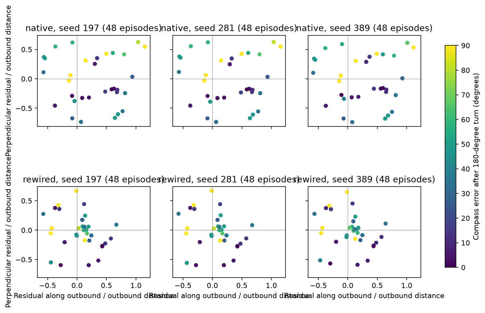

# E13 D: path-integration follow-up

Wiring provides an instantaneous vector; temporal accumulation is supplied by the model. No learning or refit in these diagnostics. The fixed observer is inverted numerically so the clamp decodes to true heading within1e-6degree; no learned gains are changed.

Steps 1–3 delivered for all three seeds. Original native/rewired PI scores reproduced within 1e-7. Existing main and 48-episode return panels used unchanged. The 180° compass-only probe uses their same scripted in-place turn; no translation feeds the compass.

|Seed|Arm|Own main /96|Clamped main /96|Own return fraction|Clamped return fraction|Median turn error deg|
|---|---|---:|---:|---:|---:|---:|
|197|native|60|80|0.65132|0.71329|40.841|
|197|rewired|22|20|0.42996|0.29601|40.841|
|281|native|60|80|0.65089|0.70989|41.058|
|281|rewired|21|20|0.42946|0.29597|41.058|
|389|native|59|80|0.64326|0.71701|38.100|
|389|rewired|23|20|0.43364|0.29226|38.100|

## Residual decomposition

|Seed|Arm|Median absolute along /outbound|Median absolute perpendicular /outbound|
|---|---|---:|---:|
|197|native|0.48725|0.35062|
|197|rewired|0.20931|0.17466|
|281|native|0.48932|0.35251|
|281|rewired|0.20854|0.17552|
|389|native|0.46568|0.33947|
|389|rewired|0.19852|0.15038|

All 288 episode points are in PI_FOLLOWUP_RETURN_EPISODES.csv. Signed components and errors are also in JSON. Clamping supplies the true heading encoded by the original initial-cue bump family/amplitude; encoding error is reported explicitly and required below 1e-6 degree. The invalid initial nominal-phase clamp is preserved in PI_FOLLOWUP_CYCLE1_INVALID_CLAMP; it was rejected before any refitting. This is an intervention on heading input, not new learned capability.

## Disposition

STOP: native clamped-heading return residual exceeds 0.30 in at least one seed. As explicitly prescribed, no refit is run. The supplied accumulator/readout package fails even with true heading; compass drift alone cannot explain failure.

