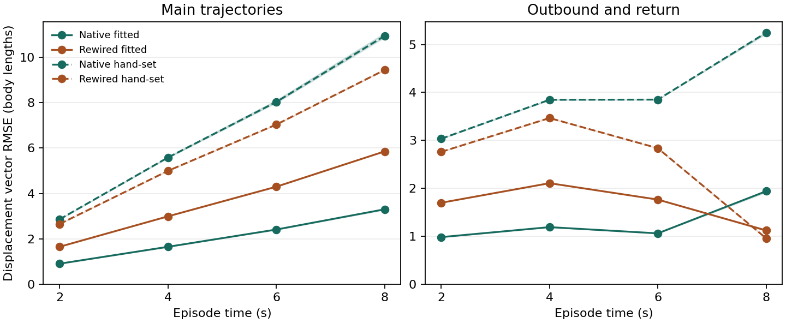

# MiniFly path integration with frozen compass gains

## Outcome

**0/3 fitting seeds met every locked gate.** Native-fitted reached 59–60/96 main episodes within 20°, versus 21–23/96 for the matched rewires. Native median magnitude ratio was 0.885–0.886. Native median decoded return residual was 0.643–0.651 of outbound distance against the 0.300 limit.

This run shows a wiring advantage on displacement direction. It did not qualify path integration. Native-fitted also left a larger median return residual than the fitted rewires, which substantially underestimated displacement magnitude on the main panel.

Both arms used the same frozen native compass vector for each seed. Only the new PFN, hΔB and PFR edges were rewired. The steering circuit remained frozen and the path probes supplied no goal or steering.

## Main and return panels

Counts use 96 main episodes. Joint success requires both ≤20° and a magnitude ratio from 0.75 to 1.25. Return medians use 48 episodes and divide the final decoded magnitude by the corresponding outbound distance. The true final displacement is zero to numerical precision. Hand-set refers to the prespecified new displacement gains in the lock, with the same fitted compass as the other arms.

| Seed | Arm | Angle ≤20° | Angle and magnitude | Median angular error | Median magnitude ratio | Median return residual / outbound |
| --- | --- | ---: | ---: | ---: | ---: | ---: |
| 197 | Native hand-set | 57/96 | 5/96 | 17.26° | 2.304 | 1.676 |
| 197 | Rewired hand-set | 2/96 | 0/96 | 142.33° | 0.387 | 0.317 |
| 197 | Native fitted | 60/96 | 45/96 | 16.42° | 0.886 | 0.651 |
| 197 | Rewired fitted | 22/96 | 11/96 | 37.96° | 0.489 | 0.430 |
| 281 | Native hand-set | 57/96 | 5/96 | 17.21° | 2.309 | 1.677 |
| 281 | Rewired hand-set | 2/96 | 0/96 | 142.14° | 0.386 | 0.315 |
| 281 | Native fitted | 60/96 | 45/96 | 16.33° | 0.886 | 0.651 |
| 281 | Rewired fitted | 21/96 | 10/96 | 37.92° | 0.489 | 0.429 |
| 389 | Native hand-set | 58/96 | 4/96 | 17.15° | 2.334 | 1.684 |
| 389 | Rewired hand-set | 2/96 | 0/96 | 142.22° | 0.395 | 0.315 |
| 389 | Native fitted | 59/96 | 45/96 | 16.53° | 0.885 | 0.643 |
| 389 | Rewired fitted | 23/96 | 11/96 | 37.73° | 0.491 | 0.434 |

## Locked criteria

| Seed | Native angle ≥72 | Median magnitude 0.75–1.25 | Return <0.30 | Angular lead ≥30 | Joint lead | Compass ≤3° regression | Outcome |
| --- | --- | --- | --- | ---: | ---: | --- | --- |
| 197 | Miss | Pass | Miss | +38 (Pass) | +34 | Pass | Miss |
| 281 | Miss | Pass | Miss | +39 (Pass) | +35 | Pass | Miss |
| 389 | Miss | Pass | Miss | +36 (Pass) | +34 | Pass | Miss |

## Displacement error over eight seconds

Vector RMSE is in body lengths. Each cell gives main / return panel RMSE. A return episode is stationary during the turnaround and reaches its starting position at eight seconds.

| Seed | Arm | 2 s | 4 s | 6 s | 8 s |
| --- | --- | ---: | ---: | ---: | ---: |
| 197 | Native hand-set | 2.861 / 3.033 | 5.574 / 3.845 | 8.001 / 3.852 | 10.882 / 5.256 |
| 197 | Rewired hand-set | 2.655 / 2.760 | 4.996 / 3.466 | 7.033 / 2.838 | 9.435 / 0.961 |
| 197 | Native fitted | 0.905 / 0.981 | 1.651 / 1.190 | 2.415 / 1.061 | 3.313 / 1.950 |
| 197 | Rewired fitted | 1.651 / 1.699 | 2.992 / 2.107 | 4.299 / 1.765 | 5.857 / 1.128 |
| 281 | Native hand-set | 2.857 / 3.030 | 5.570 / 3.841 | 8.000 / 3.850 | 10.892 / 5.257 |
| 281 | Rewired hand-set | 2.655 / 2.759 | 4.995 / 3.465 | 7.032 / 2.837 | 9.437 / 0.962 |
| 281 | Native fitted | 0.904 / 0.980 | 1.650 / 1.189 | 2.415 / 1.061 | 3.312 / 1.951 |
| 281 | Rewired fitted | 1.652 / 1.699 | 2.993 / 2.108 | 4.299 / 1.765 | 5.856 / 1.130 |
| 389 | Native hand-set | 2.866 / 3.038 | 5.616 / 3.856 | 8.107 / 3.849 | 11.062 / 5.222 |
| 389 | Rewired hand-set | 2.656 / 2.760 | 5.003 / 3.467 | 7.051 / 2.836 | 9.464 / 0.952 |
| 389 | Native fitted | 0.907 / 0.984 | 1.647 / 1.192 | 2.400 / 1.060 | 3.282 / 1.918 |
| 389 | Rewired fitted | 1.652 / 1.698 | 2.992 / 2.107 | 4.297 / 1.766 | 5.853 / 1.108 |

## Compass regression

Replayed the original official panels and matched every native score to the prior receipt. The same frozen compass and steering parameters are used in both path-integration arms. The three median heading errors below each changed by 0.00°.

| Seed | Stationary median | Dark-turn median | Combined median |
| --- | ---: | ---: | ---: |
| 197 | 5.27° | 8.91° | 9.80° |
| 281 | 5.21° | 8.93° | 9.91° |
| 389 | 5.35° | 8.67° | 9.83° |

## Which routes the fit uses

The native hΔB state receives PFNd and PFNv branch drives with RMS 0.1777–0.2005 and 0.0212–0.0268, respectively. On the same main episodes, removing the PFNd branch yielded 44, 44, 44/96 angle successes by seed. Removing PFNv yielded 60, 60, 61/96, and removing hΔB recurrence yielded 60, 60, 59/96. The fitted hΔB recurrence coefficient was 0.00005–0.00006 per step, and zeroing it left the main angle counts unchanged. PFNd contributed materially to angular success. PFNv contributed a smaller signal and its removal did not lower the main angle counts. The hΔB state and hΔB→PFR projection are the only path to the decoder by construction. The paired gain products and shared readout scale limit interpretation of individual gain values.

## Three cycles

1. Verified the signed projection and rewiring invariants, zero-motion output, and round-trip labels. Replayed the frozen official compass and steering probes.
2. Compared the blocked recurrence against 160 explicit state updates. Maximum difference was 2.2e-14 body lengths. Central-difference gradients agreed within 2.3e-08, and two Adam updates replayed exactly.
3. Completed all six 2,048-update fits and saved final iterates before scoring the sealed panels. The 384 training episodes comprised 288 main-style and 96 return-style episodes with independent headings and speeds. Native training vector MSE improved by at most 0.004 body lengths squared in the final 512 updates.

## Model scope

The previous v630 velocity route supplies the signed EPG→PFNd/PFNv→hΔB→PFR projections. The extension also uses signed hΔB recurrent edges and declares ten new scalars. The model uses forward speed to modulate PFN activity relative to tonic firing. It updates the hΔB displacement state every 50 ms, then reads it through PFR. The temporal accumulator is a specified model mechanism. The published studies establish the pathway for instantaneous travel direction and motivate the cell types. [Lyu et al.](https://www.nature.com/articles/s41586-021-04067-0) · [Lu et al.](https://pmc.ncbi.nlm.nih.gov/articles/PMC10759448/)

Prior probes supplied yaw schedules and had no translational speed distribution. This lock carries over the six dark-turn schedules and declares a shared forward-speed range of 0.5–1.5 body lengths/s. The same 15 original parameters were held fixed throughout. The compass loss is constant with respect to the new gains because the new pathway does not feed back to EPG.

[Protocol and parameter manifest](PI_LOCK.json) · [Scores, per-episode results and checkpoint curves](PI_RESULTS.json) · [Fitted gain vectors and training curves](PI_CURVES.json)
